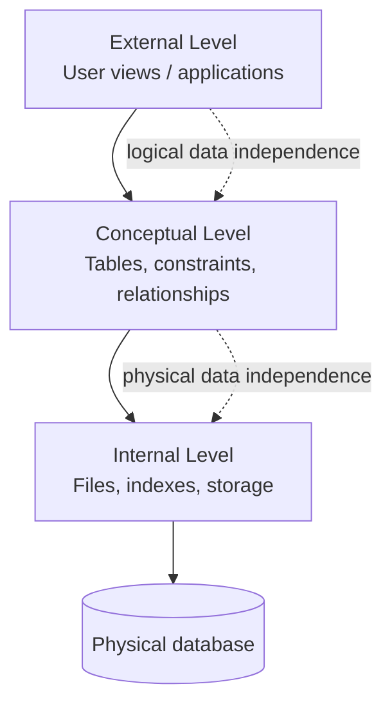
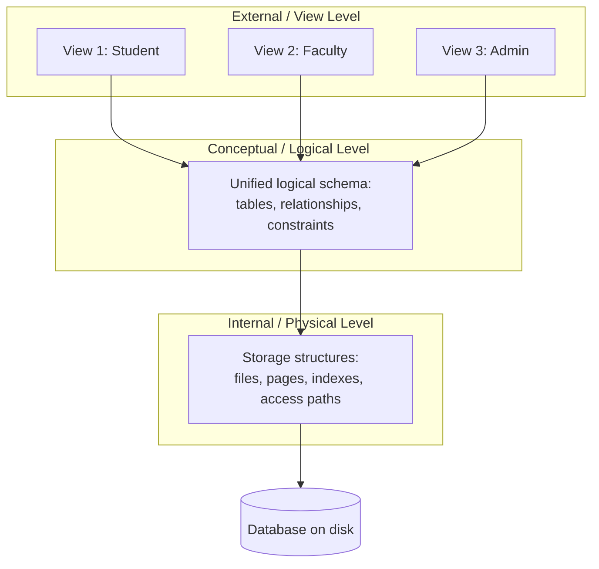
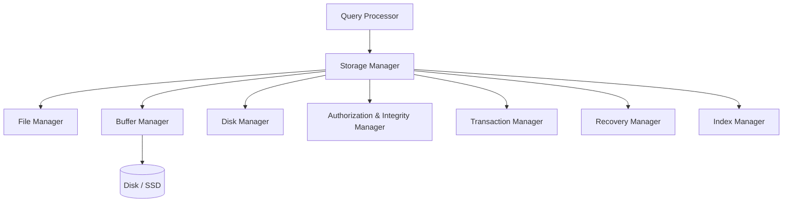

# Unit 1 — Introduction to Database Concepts

> **Syllabus (DJS23IPC202, 4 hrs):** Introduction, characteristics of databases, file system vs database system, users of database system, schema and instance, data independence, DBMS system architecture, Database Administrator.
>
> **Past-paper coverage:** DBMS definition & characteristics, file system vs DBMS, schema vs instance, logical/physical data independence, database users, DBA role, three-level architecture/view levels, storage-manager components.

**Source codes used in this file**

| Code | Paper |
|---|---|
| IT-F24 | IT, Final Exam 2024-25 (09 Dec 2024), DJS23ICPC302 |
| IT-R25 | IT, Re-Exam 2024-25 (22 Mar 2025), DJS23ICPC302 |
| CO-B26 | Comp/DS/AIDS/IT, Backlog Re-Exam 2023-24 (16 Mar 2026) |
| IO-F24 | CSE (IOT & Cyber Security), Final Exam 2024-25 (09 Dec 2024), DJS23BCPC303 |
| IT-F25 | IT, Final Exam 2025-26 (04 Dec 2025) |
| IT-R26 | IT, Re-Exam 2025-26 (16 Mar 2026) |
| AI-R26 | AI & DS, Re-Exam 2025-26 (16 Mar 2026) |
| IC-R26 | CSE (IOT & Cyber Security with Blockchain), Re-Exam 2025-26 (16 Mar 2026) |

---

## Q1.1 Define DBMS. Explain the characteristics of a database system. **[5]**

**Asked in:** AI-R26 Q3(B) (define DBMS + characteristics), IT-F24-style short question.

**Question (verbatim):**
> Define Database Management Systems and Discuss is characteristics.

**Answer**

A **Database Management System (DBMS)** is software that stores, manages, retrieves and controls access to data in a database. It acts as an intermediary between users/application programs and the physical database, providing a controlled, efficient and secure environment for data storage and concurrent access.

**Characteristics of a database system**

1. **Data abstraction / multiple views** — users see only the portion of data relevant to them; physical storage details are hidden.
2. **Reduced redundancy and controlled inconsistency** — data is stored centrally; normalization avoids unnecessary duplication.
3. **Data independence** — changes in storage structure or logical schema do not force changes in application programs.
4. **Concurrent access and concurrency control** — many users/transactions can access data simultaneously without corrupting it.
5. **Transaction support (ACID)** — atomicity, consistency, isolation and durability are guaranteed.
6. **Integrity constraints** — domain, key, referential and check constraints protect correctness.
7. **Security and authorization** — users are granted/revoked privileges on database objects.
8. **Backup and recovery** — the DBMS can restore a consistent state after a failure.
9. **Efficient data access** — indexes, query optimisation and storage managers provide fast retrieval.
10. **Centralized control / data sharing** — one copy of data is shared by multiple applications and users.

> **Exam tip:** For 5 marks, write the definition (1 mark) + any five characteristics with one line each (4 marks).

---

## Q1.2 Differentiate between a file system and a database system with suitable examples. **[5]**

**Asked in:** IT-F25 Q3(A)(2).

**Question (verbatim):**
> Differentiate between File System and Database System with suitable examples.

**Answer**

| Point | File System | Database System (DBMS) |
|---|---|---|
| Data storage | Each application keeps its own files | Central database shared by applications |
| Redundancy | High — same data repeated in many files | Low — controlled redundancy through normalization |
| Consistency | Inconsistency likely when one copy is updated | Constraints and transactions maintain consistency |
| Concurrency | Little/no concurrency control | Concurrency control (locks, timestamps) |
| Security | File-level permissions only | Fine-grained authorization: GRANT/REVOKE, roles, views |
| Recovery | Manual/application-specific | Log-based recovery, checkpoints, backup |
| Querying | Program code must search files | Declarative SQL, query optimizer |
| Data independence | Programs tightly coupled to file layout | Logical/physical data independence |
| Integrity | Enforced in application code | Declarative constraints (PK, FK, CHECK, NOT NULL) |
| Example | A university stores student details in `student.txt`, fees in `fees.txt`, marks in `marks.txt`; changing an address means editing several files | One `STUDENT` table is referenced by fees and marks modules; one update is visible everywhere |

**Example explanation:** In a file-based university system, if a student changes address, every file containing the address must be updated; missing one file creates inconsistency. In a DBMS, the address exists once in the `STUDENT` table, and all applications read the same value.

---

## Q1.3 Define database schema and database instance. Give examples. **[5]**

**Asked in:** IT-F24 Q3(A)(2); IT-R26 Q3(A)(2) (schema vs instance).

**Questions (verbatim):**
> Define Database schema and Database instance. Provide examples for each.
>
> What do you mean by "database schema" and "instance"? Discuss with the help of examples.

**Answer**

- **Database schema** — the *logical structure* or design of the database. It defines tables, attributes, data types, keys, constraints and relationships. It changes rarely.
- **Database instance** — the *actual data* stored in the database at a particular moment in time. It changes frequently as rows are inserted, updated or deleted.

**Example**

Schema:
```sql
STUDENT(RollNo INT PRIMARY KEY, Name VARCHAR(50), Age INT, City VARCHAR(30));
```

Instance at 10:00 a.m.:

| RollNo | Name | Age | City |
|---|---|---|---|
| 101 | Aarav | 20 | Mumbai |
| 102 | Diya | 19 | Pune |

Instance at 11:00 a.m. after inserting a row:

| RollNo | Name | Age | City |
|---|---|---|---|
| 101 | Aarav | 20 | Mumbai |
| 102 | Diya | 19 | Pune |
| 103 | Rohan | 21 | Nashik |

The schema is unchanged; only the instance has changed.

> **One-line distinction:** Schema = *design* (intension); instance = *data at a moment* (extension).

---

## Q1.4 What is data independence? Explain logical and physical data independence with examples. **[5–7]**

**Asked in:** IO-F24 Q1(b)(i) **[7]**; IC-R26 Q1(a).

**Question (verbatim):**
> What do you mean by data independence? Explain logical and physical data independence with examples.

**Answer**

**Data independence** is the ability to change the schema at one level of the database system without requiring changes at the next higher level. It is a direct benefit of the three-level DBMS architecture.

### 1. Logical data independence

The ability to change the **conceptual schema** (logical design) without changing the **external schema** (user views) or application programs.

**Examples**

- Adding a new column `Email` to the `STUDENT` table; existing applications that select only `RollNo, Name` continue to work.
- Splitting a table into two tables and defining a view that presents the original structure to applications.
- Changing a relationship or adding a new entity without rewriting user programs.

### 2. Physical data independence

The ability to change the **internal/physical schema** (storage structures, file organization, indexes) without changing the **conceptual schema**.

**Examples**

- Adding or dropping an index on `STUDENT(RollNo)`.
- Changing a heap file to a B+ tree file organization.
- Moving the database to a different disk or changing the block size.
- Changing the storage engine or compression method.

**Diagram**



> **Exam tip:** State the definition, then one example for each type. Mention that logical independence is harder to achieve than physical independence.

---

## Q1.5 What are the main types of database users? How do their roles differ? **[7]**

**Asked in:** IO-F24 Q1(b)(ii) **[7]**.

**Question (verbatim):**
> What are the main types of Database Users? How do their roles differ in the context of a Database Management System?

**Answer**

| User type | Role | Typical responsibilities |
|---|---|---|
| **Database Administrator (DBA)** | Overall control of the database system | Schema design, storage/access strategy, security, backup/recovery, performance tuning, user support |
| **Database designers / data architects** | Design the logical and physical structure | Identify entities, relationships, constraints; map ER model to relational schema; plan storage |
| **Application programmers / developers** | Build programs that use the database | Write SQL/embedded SQL, triggers, procedures; develop user interfaces |
| **End users** | Use the database through applications | Query and update data relevant to their work |
| ↳ *Casual users* | Occasional, ad-hoc access | Generate reports, run queries |
| ↳ *Naive/parametric users* | Repetitive, predefined operations | Bank teller, ticket clerk, data-entry operator |
| ↳ *Sophisticated users* | Deep technical users | Analysts, scientists writing complex queries |
| **System analysts** | Bridge between users and technical team | Gather requirements, specify database functionality |

**How roles differ:** The DBA has the highest privileges and is responsible for the whole system; designers decide *what* the database looks like; programmers build the *application layer*; end users only perform business tasks through controlled interfaces; system analysts translate business needs into technical requirements.

---

## Q1.6 Discuss the role of the Database Administrator (DBA) in a DBMS. **[5]**

**Asked in:** IT-R25 Q3(A)(2) **[5]**.

**Question (verbatim):**
> Discuss the role of the Database Administrator in DBMS?

**Answer**

A **Database Administrator (DBA)** is the person or team responsible for installing, configuring, managing and protecting the database system. The DBA has the highest level of access and authority.

**Main responsibilities**

1. **Database design and schema management** — decide the content, logical schema and physical storage structure.
2. **Storage and access strategy** — choose file organization, indexes and disk allocation.
3. **Security and authorization** — create users/roles, grant and revoke privileges, enforce access policies.
4. **Integrity enforcement** — define constraints, triggers and validation rules.
5. **Backup and recovery** — plan backups, checkpoints and recovery procedures; restore the database after failure.
6. **Performance tuning** — monitor query performance, tune indexes, buffer pool and query plans.
7. **Concurrency control** — ensure transactions do not interfere and deadlocks are handled.
8. **User support and documentation** — train users, maintain metadata and standards.
9. **Capacity planning and replication** — plan growth, disk space and data distribution.

> **Exam tip:** List 6–7 responsibilities; one line each is enough for 5 marks.

---

## Q1.7 Discuss the various view levels in DBMS / the three-level DBMS architecture. **[5–10]**

**Asked in:** CO-B26 Q2(B)(i) **[5]**.

**Question (verbatim):**
> Discuss the various view levels in DBMS.

**Answer**

The DBMS architecture is commonly described by the **three-schema (three-level) architecture**:



1. **External level (view level)** — describes the part of the database each user group needs. It hides irrelevant data and provides security. A view is defined using SQL `CREATE VIEW`.
2. **Conceptual level (logical level)** — describes *what* data is stored and the relationships/constraints among it. It is the complete logical design (tables, keys, integrity rules), independent of physical storage.
3. **Internal level (physical level)** — describes *how* data is stored: file organization, record layout, indexes, block sizes, buffers and access paths.

**Mappings**

- **External/conceptual mapping** — maps each view to the conceptual schema.
- **Conceptual/internal mapping** — maps the conceptual schema to physical storage.

**Data independence**

- Changes at the conceptual level should not affect external views → **logical data independence**.
- Changes at the internal level should not affect the conceptual schema → **physical data independence**.

**Advantages:** data abstraction, security, customization of views, and insulation of applications from storage changes.

---

## Q1.8 With respect to DBMS system architecture, discuss the components of the storage manager. **[5–10]**

**Asked in:** CO-B26 Q2(B)(ii) **[5]**.

**Question (verbatim):**
> With respect to the DBMS System Architecture, discuss the components of storage manager.

**Answer**

The **storage manager** is the DBMS component that provides the interface between the low-level data stored on disk and the higher-level query/transaction components. Its main components are:

| Component | Function |
|---|---|
| **File manager** | Allocates disk space, manages files and records, and tracks the physical location of data |
| **Buffer manager** | Brings pages from disk into main memory (buffer pool), decides replacement (LRU, clock), and writes dirty pages back |
| **Disk manager / device manager** | Performs low-level disk I/O, scheduling and block transfers |
| **Authorization and integrity manager** | Checks user privileges and integrity constraints before operations |
| **Transaction manager** | Ensures transactions are atomic, consistent, isolated and durable; coordinates commit/rollback |
| **Recovery manager** | Maintains the log and restores a consistent state after a crash |
| **Index manager** | Maintains indexes (B-tree, B+ tree, hash) and uses them to locate records efficiently |



> **Exam tip:** Draw the block diagram, then explain any five components in one line each.

---

## Unit 1 — quick revision checklist

- [ ] DBMS definition + 5 characteristics
- [ ] File system vs DBMS (table of 6–8 differences)
- [ ] Schema vs instance with a small example
- [ ] Logical vs physical data independence with examples
- [ ] Five types of database users and their roles
- [ ] Seven responsibilities of a DBA
- [ ] Three-level architecture diagram + mappings
- [ ] Storage-manager components block diagram
