# Unit 2 — Relational Data Model (ER/EER, Keys, Mapping, Relational Algebra)

> **Syllabus (DJS23IPC202, 10 hrs):** Entity–Relationship model — entity types, weak/strong entity sets, entity sets, types of attributes, keys, relationship constraints (cardinality and participation); Extended ER model — generalization, specialization, aggregation; relational model — relational schema and concept of keys, mapping ER/EER to relational model; relational algebra — unary and set operations, relational algebra queries.
>
> **Past-paper coverage:** ER diagrams for 10+ scenarios, EER specialization/generalization/aggregation, subclass constraints (total/partial, disjoint/overlapping, lattice, union type), keys, ER/EER-to-relational mapping, relational algebra queries.

**Source codes**

| Code | Paper |
|---|---|
| IT-F24 | IT Final 2024-25 (Dec 2024) |
| IT-R25 | IT Re-Exam 2024-25 (Mar 2025) |
| CO-F24 | Comp Final 2024-25 (Dec 2024) |
| CO-R25 | Comp Re-Exam 2024-25 (Mar 2025) |
| IO-F24 | IOT Final 2024-25 (Dec 2024) |
| DS-F24 | DS Final 2024-25 (Dec 2024) |
| DS-R25 | DS Re-Exam 2024-25 (Mar 2025) |
| IT-F25 | IT Final 2025-26 (Dec 2025) |
| IT-R26 | IT Re-Exam 2025-26 (Mar 2026) |
| AI-R26 | AIDS Re-Exam 2025-26 (Mar 2026) |
| IC-R26 | CSE (ICB) Re-Exam 2025-26 (Mar 2026) |
| CO-R26 | Comp Re-Exam 2024-25 batch (Mar 2026) |
| CO-B26 | 2023-24 Backlog Re-Exam (Mar 2026) |

---

# Part A — ER / EER Modelling

## 2.1 Library Management System (EER) **[10]**

**Asked in:** AI-R26 Q1(A)(i).

**Question (verbatim):**
> The Library Management System database keeps track of readers with the following considerations - The system keeps track of the staff with a single point authentication system comprising login Id and password. Staff maintains the book catalog with its ISBN, Book title, price(in INR), category(novel, general, story), edition, author Number and details. A publisher has publisher Id, Year when the book was published, and name of the book. Readers are registered with their user_id, email, name (first name, last name), Phone no (multiple entries allowed), communication address. The staff keeps track of readers. Readers can return/reserve books that stamps with issue date and return date. If not returned within the prescribed time period, it may have a due date too. Staff also generate reports that has readers id, registration no of report, book no and return/issue info. Draw an E-R diagram for above Scenario.

**Problem summary:** Staff log in with a login ID/password; staff maintain the book catalogue (ISBN, title, price, category, edition, author number/details); publishers have a publisher ID and name; readers have user ID, email, first/last name, multiple phone numbers and address; readers reserve/return books with issue date, return date and due date; staff generate reports containing reader ID, report registration number, book number and issue/return information.

**Entities and attributes**

| Entity | Attributes (PK underlined) |
|---|---|
| STAFF | <u>StaffID</u>, LoginID, Password, Name |
| PUBLISHER | <u>PublisherID</u>, PublisherName |
| BOOK | <u>ISBN</u>, Title, Price, Category, Edition |
| AUTHOR | <u>AuthorID</u>, AuthorName, AuthorDetails |
| READER | <u>UserID</u>, Email, FirstName, LastName, Address |
| READER_PHONE | <u>UserID, Phone</u> (multi-valued attribute converted to a relation) |
| BOOK_COPY | <u>CopyNo</u>, ISBN, Status |
| LOAN | <u>LoanID</u>, UserID, CopyNo, IssueDate, ReturnDate, DueDate |
| REPORT | <u>ReportID</u>, StaffID, UserID, CopyNo, IssueReturnInfo |

**Relationships**

- PUBLISHER **publishes** BOOK — 1:M (one publisher publishes many books; each book has one publisher).
- AUTHOR **writes** BOOK — M:N (a book can have multiple authors; an author can write many books).
- BOOK **has** BOOK_COPY — 1:M.
- READER **borrows** BOOK_COPY through LOAN — M:N with attributes IssueDate, ReturnDate, DueDate.
- STAFF **maintains** BOOK — 1:M.
- STAFF **tracks** READER — 1:M.
- STAFF **generates** REPORT — 1:M.
- REPORT **refers to** READER and BOOK_COPY — M:1 each.

**EER note:** `READER_PHONE` is a multi-valued attribute modelled as a weak entity/relation. `BOOK_COPY` is a weak entity of BOOK (a copy cannot exist without its book). A `LOAN` is an associative entity between READER and BOOK_COPY.

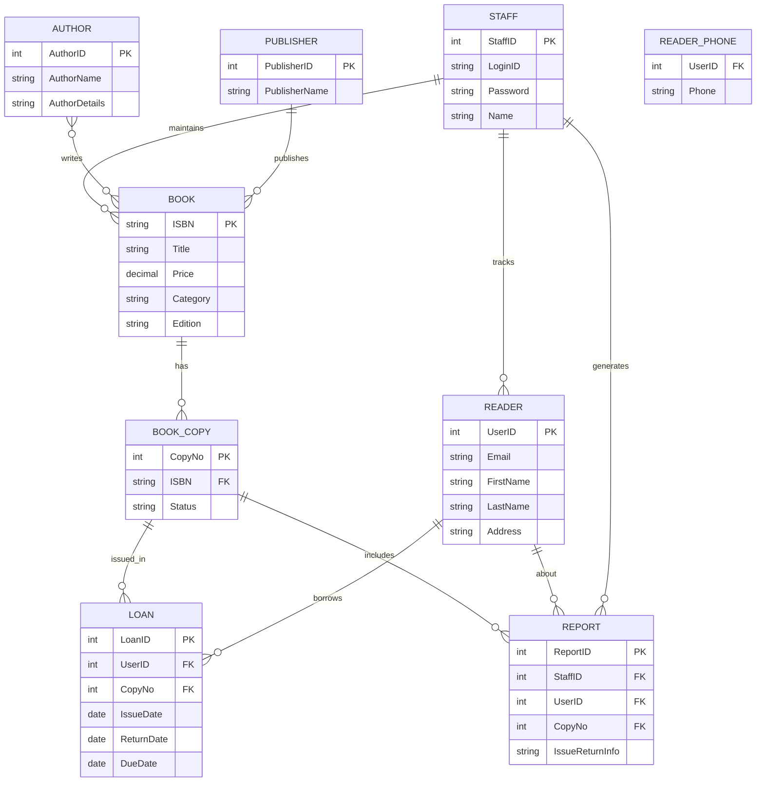

---

## 2.2 Hospital Management System (EER with specialization/generalization) **[10]**

**Asked in:** CO-F24 Q1(A).

**Question (verbatim):**
> Draw an EER diagram for Hospital Management System by Specialization and Generalization features of EER. Include Entities like Patient, Doctor, Payment, Nurses, Rooms, etc. Add Appropriate Cardinalities and participation where ever required.

**Entities:** PATIENT, DOCTOR, NURSE, WARD, ROOM, PAYMENT, STAFF (superclass), ADMIN_STAFF (subclass).

**Attributes**

- PATIENT(<u>PatientID</u>, Name, Age, Gender, Address, Phone)
- DOCTOR(<u>DoctorID</u>, Name, Specialty, Qualification, ConsultationFee)
- NURSE(<u>NurseID</u>, Name, Shift, Qualification)
- WARD(<u>WardNo</u>, WardType, Capacity)
- ROOM(<u>RoomNo</u>, RoomType, Charges, WardNo)
- PAYMENT(<u>PaymentID</u>, Amount, Date, Mode, PatientID)
- STAFF(<u>StaffID</u>, Name, Address, Phone, Salary)
- ADMIN_STAFF(<u>StaffID</u>, Designation, Department)

**Relationships and cardinalities**

- PATIENT **is treated by** DOCTOR — M:N (a patient may consult several doctors; a doctor treats many patients). Attribute: Date, Diagnosis.
- PATIENT **is admitted to** ROOM — 1:M (one room can be occupied by several patients over time; a patient has one current room).
- ROOM **belongs to** WARD — M:1.
- DOCTOR **is assigned to** WARD — 1:M.
- NURSE **attends** PATIENT — M:N.
- PAYMENT **is made by** PATIENT — M:1.
- DOCTOR and NURSE are **subclasses of** STAFF (specialization); ADMIN_STAFF is another subclass.

**EER specialization**

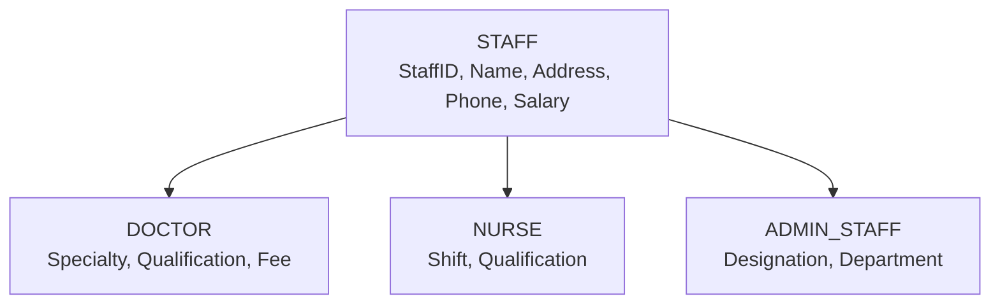

**Participation/cardinality notes:** The specialization is **total** (every staff member must be a doctor, nurse or admin staff) and **disjoint** (a staff member cannot be both a doctor and a nurse) in this design. If a person can be both, use overlapping (`o`).

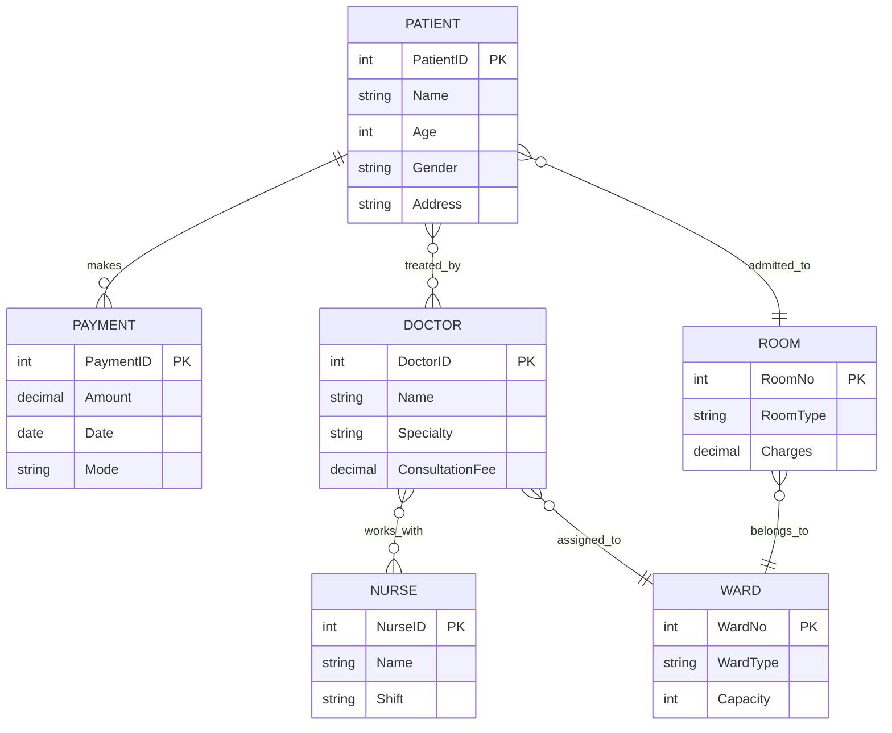

---

## 2.3 Banking Database (EER with specialization/generalization) **[10]**

**Asked in:** CO-R25 Q1(A).

**Question (verbatim):**
> Construct an ER diagram for a banking Database system. Consider various entities such as Account, Customer, branch, Loan, Deposit Borrower, etc. Design Specialization and Generalization EER Feature.

**Entities:** CUSTOMER, ACCOUNT, BRANCH, LOAN, DEPOSIT, BORROWER.

**Attributes**

- CUSTOMER(<u>CustomerID</u>, Name, Address, Phone, Type)
- ACCOUNT(<u>AccountNo</u>, Balance, BranchID, CustomerID, Type)
- BRANCH(<u>BranchID</u>, BranchName, City, Assets)
- LOAN(<u>LoanNo</u>, Amount, InterestRate, BranchID, CustomerID)
- DEPOSIT(<u>DepositID</u>, Amount, Date, AccountNo)
- BORROWER(<u>CustomerID, LoanNo</u>, Date)

**Relationships**

- CUSTOMER **owns** ACCOUNT — M:N (joint accounts); simplified to 1:M if each account has one owner.
- BRANCH **has** ACCOUNT — 1:M.
- BRANCH **offers** LOAN — 1:M.
- CUSTOMER **borrows** LOAN through BORROWER — M:N with Date.
- ACCOUNT **has** DEPOSIT — 1:M.

**EER specialization**

- ACCOUNT → SAVINGS_ACCOUNT (InterestRate, MinBalance), CURRENT_ACCOUNT (OverdraftLimit).
- CUSTOMER → INDIVIDUAL (DOB, Aadhaar), CORPORATE (RegistrationNo, GSTNo).
- LOAN → HOME_LOAN (PropertyAddress), CAR_LOAN (VehicleNo), PERSONAL_LOAN (Purpose).

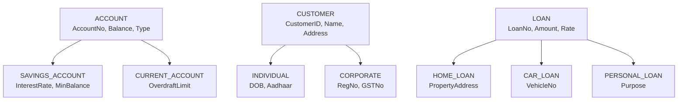

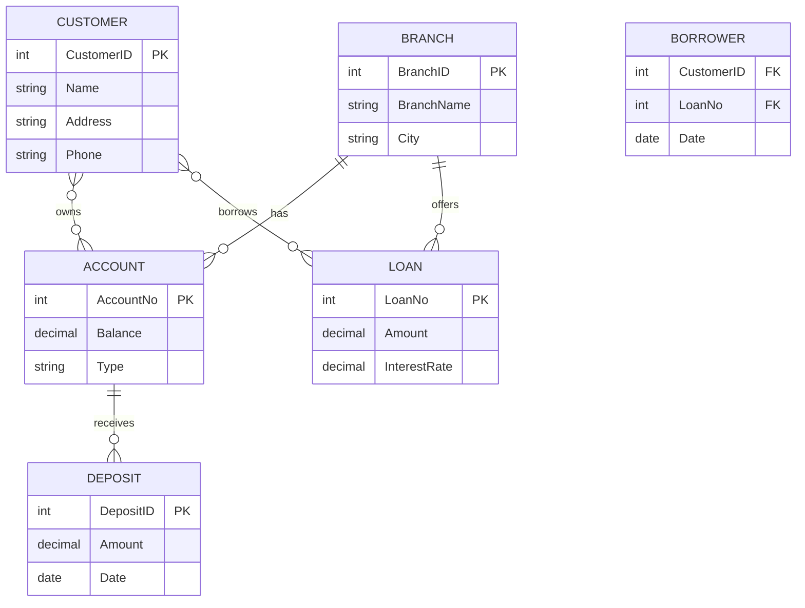

---

## 2.4 Personal Music Library **[8]**

**Asked in:** IO-F24 Q2(a).

**Question (verbatim):**
> Create the ER diagram for personal music library music database. It is used to manage your personal music collection. The relationship is between artists, albums, and tracks. The collection consists of albums. An album is made by exactly one artist. An artist makes one or more albums. An album contains one or more tracks Artists, albums, and tracks each have a name. Each track is on exactly one album. Each track has a time length, measured in seconds. When a track is played, the date and time the playback began (to the nearest second) should be recorded; this is used for reporting when a track was last played, as well as the number of times music by an artist, from an album, or a track has been played.

**Problem summary:** Manage a personal music collection of artists, albums and tracks. An album is made by exactly one artist; an artist makes one or more albums; an album contains one or more tracks. Artists, albums and tracks each have a name. Each track is on exactly one album and has a length in seconds. When a track is played, record the date and time playback began, to report last-played time and play counts by artist/album/track.

**Entities and attributes**

- ARTIST(<u>ArtistID</u>, Name)
- ALBUM(<u>AlbumID</u>, Name, ArtistID)
- TRACK(<u>TrackID</u>, Name, LengthSeconds, AlbumID)
- PLAY(<u>PlayID</u>, TrackID, PlayDateTime)

**Relationships**

- ARTIST **makes** ALBUM — 1:M (each album has exactly one artist).
- ALBUM **contains** TRACK — 1:M (each track belongs to exactly one album).
- TRACK **is played in** PLAY — 1:M (a track can be played many times).
- Artist/album play counts are derived by joining PLAY → TRACK → ALBUM → ARTIST.

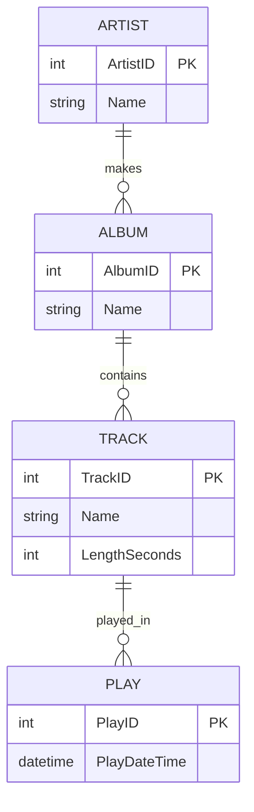

**Answer tip:** Show total participation of ALBUM in "makes" (every album must have an artist) and total participation of TRACK in "contains" (every track must be on an album). The PLAY entity is weak/dependent on TRACK.

---

## 2.5 Hotel Management System (EER) **[5–10]**

**Asked in:** DS-F24 Q1(A) **[5]**; CO-R26 Q1(A) **[10]**.

**Questions (verbatim):**
> Create an Extended ER diagram for a hotel management system, identifying key entities, their attributes, and relationships with appropriate cardinalities and constraints. Include any relevant specialization or generalization, such as different room types or employee roles.
>
> Construct an EER diagram for Hotel Management System system by including at least one Specialization and Generalization Feature of EER with appropriate entities, Relations and attributes.

**Entities:** HOTEL, ROOM, ROOM_TYPE, GUEST, BOOKING, PAYMENT, EMPLOYEE.

**Attributes**

- HOTEL(<u>HotelID</u>, Name, City, Address, Rating)
- ROOM(<u>RoomNo</u>, HotelID, RoomTypeID, Floor, Status)
- ROOM_TYPE(<u>RoomTypeID</u>, TypeName, Tariff, Capacity)
- GUEST(<u>GuestID</u>, Name, Address, Phone, Email)
- BOOKING(<u>BookingID</u>, GuestID, RoomNo, CheckInDate, CheckOutDate, Status)
- PAYMENT(<u>PaymentID</u>, BookingID, Amount, Date, Mode)
- EMPLOYEE(<u>EmpID</u>, Name, Role, Salary, HotelID)

**Relationships**

- HOTEL **has** ROOM — 1:M.
- ROOM **is of** ROOM_TYPE — M:1.
- GUEST **makes** BOOKING — 1:M.
- BOOKING **reserves** ROOM — M:N over time (a room can be booked on different dates; a booking may include multiple rooms).
- BOOKING **has** PAYMENT — 1:M.
- HOTEL **employs** EMPLOYEE — 1:M.

**EER specialization:** ROOM → SINGLE, DOUBLE, SUITE; EMPLOYEE → MANAGER, RECEPTIONIST, HOUSEKEEPING; GUEST → REGULAR, VIP. Show total/disjoint constraints.

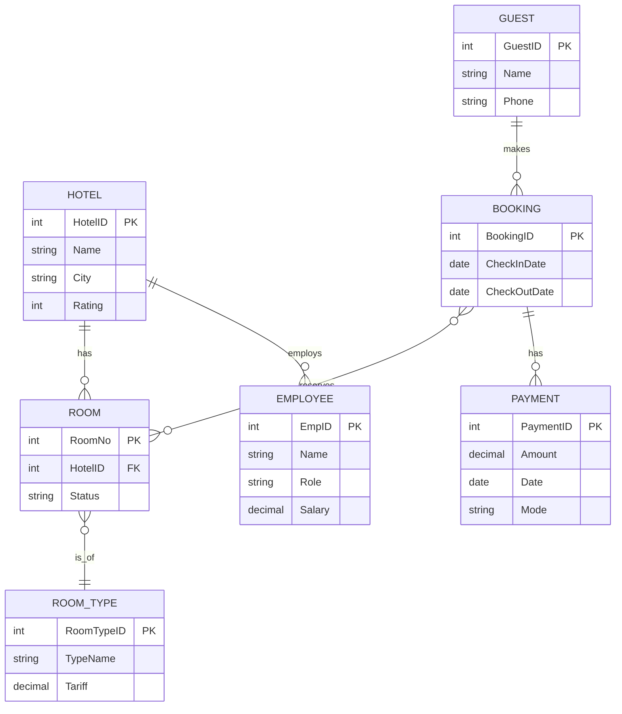

---

## 2.6 Airline Reservation System **[10]**

**Asked in:** IT-R26 Q1(A)(I).

**Question (verbatim):**
> Write a detailed problem statement and draw an ER Diagram for Airline Reservation System.

**Problem statement (write this in the exam):** An airline operates many flights between airports. Each flight has a unique flight number, a source airport, a destination airport, departure/arrival times, and an aircraft. Passengers make bookings for one or more flights; each booking has a booking ID, booking date, number of passengers, total fare and payment details. Each passenger has a unique passenger ID, name, gender, date of birth, passport number, phone and email. Each flight uses one aircraft, and each aircraft has a registration number, model and seating capacity. Seats are identified by seat number and class (economy/business/first). A booking reserves one or more seats on a flight. Payments are made for bookings with amount, mode, date and status.

**Entities:** PASSENGER, FLIGHT, AIRPORT, AIRCRAFT, SEAT, BOOKING, PAYMENT.

**Relationships**

- FLIGHT **departs from** AIRPORT — M:1.
- FLIGHT **arrives at** AIRPORT — M:1.
- FLIGHT **uses** AIRCRAFT — M:1.
- PASSENGER **makes** BOOKING — 1:M.
- BOOKING **is for** FLIGHT — M:1.
- BOOKING **reserves** SEAT — M:N (a booking can reserve several seats; a seat is reserved per flight/date).
- BOOKING **has** PAYMENT — 1:M.

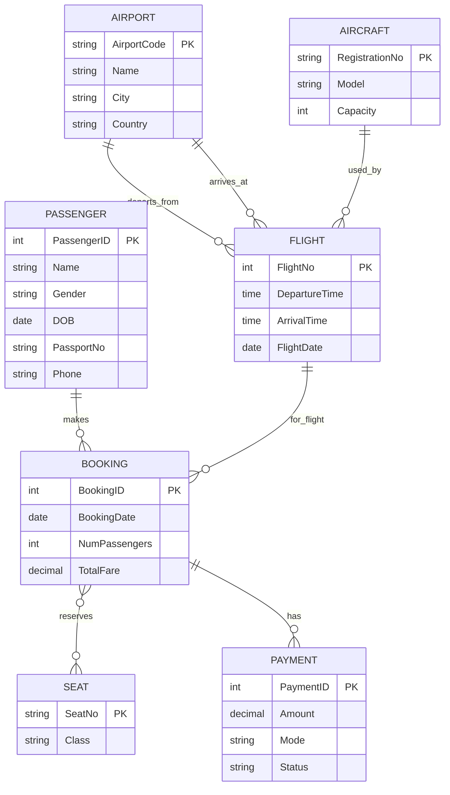

---

## 2.7 College Management System **[5]**

**Asked in:** DS-R25 Q1(A).

**Question (verbatim):**
> Create an ER diagram for a college management system by identifying the main entities, their attributes, and how they are related. Clearly show the connections with the right cardinalities and constraints.

**Entities:** STUDENT, FACULTY, COURSE, DEPARTMENT, HOSTEL, EXAM.

**Relationships**

- DEPARTMENT **offers** COURSE — 1:M.
- STUDENT **enrols in** COURSE — M:N (attribute: Semester, Grade).
- FACULTY **teaches** COURSE — M:N.
- STUDENT **belongs to** DEPARTMENT — M:1.
- STUDENT **resides in** HOSTEL — M:1.
- STUDENT **appears for** EXAM — M:N (attribute: Marks).

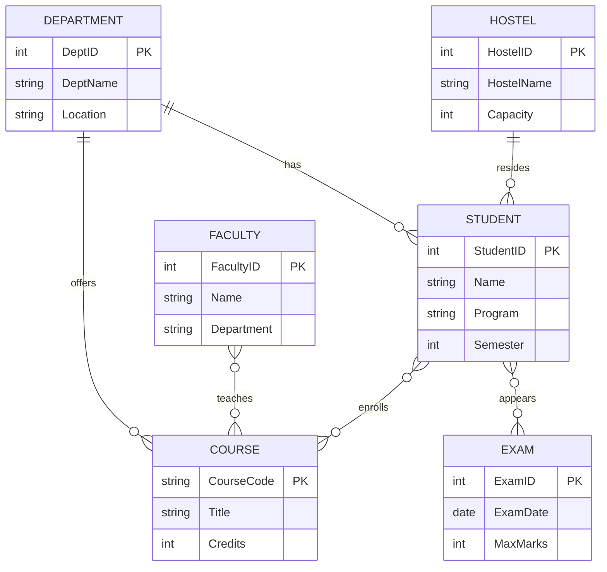

---

## 2.8 University Registrar's Office **[10]**

**Asked in:** IC-R26 Q2(a).

**Question (verbatim):**
> A university registrar’s office maintains data about the following entities:
> 1. courses, including number, title, credits, syllabus, and prerequisites;
> 2. course offerings, including course number, year, semester, section number, instructor(s), timings, and classroom;
> 3. students, including student-id, name, and program;
> 4. instructors, including identification number, name, department, and title.
> Further, the enrollment of students in courses and grades awarded to students in each course they are enrolled for must be appropriately modeled. Construct an E-R diagram for the registrar’s office.

**Entities and attributes**

- COURSE(<u>CourseNo</u>, Title, Credits, Syllabus)
- COURSE_OFFERING(<u>OfferingID</u>, CourseNo, Year, Semester, SectionNo, Timing, Classroom)
- STUDENT(<u>StudentID</u>, Name, Program)
- INSTRUCTOR(<u>InstructorID</u>, Name, Department, Title)
- ENROLLMENT(<u>StudentID, OfferingID</u>, Grade)
- PREREQUISITE(<u>CourseNo, PrereqCourseNo</u>)

**Relationships**

- COURSE **has** PREREQUISITE — M:N recursive (a course can have many prerequisites; a course can be a prerequisite for many courses).
- COURSE_OFFERING **is an offering of** COURSE — M:1.
- INSTRUCTOR **teaches** COURSE_OFFERING — M:N (an instructor can teach several offerings; an offering can have several instructors).
- STUDENT **enrols in** COURSE_OFFERING — M:N with Grade (associative entity ENROLLMENT).

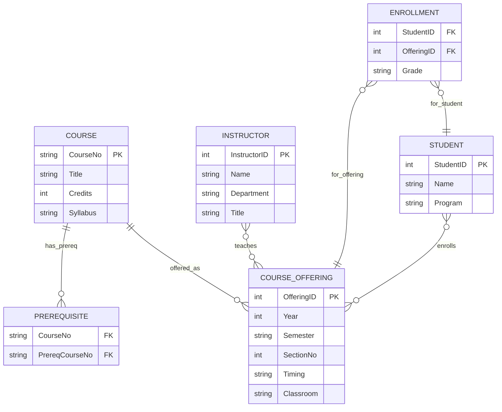

---

## 2.9 University Students, Courses and Instructors **[10]**

**Asked in:** CO-B26 Q1(A)(i).

**Question (verbatim):**
> A university wants to keep track of its students, courses, and instructors. Each student is assigned a student ID and takes several courses. Each course has a course code and is taught by one instructor. An instructor is identified by an instructor ID. Draw an E-R diagram for this university database.

**Entities:** STUDENT(<u>StudentID</u>, Name), COURSE(<u>CourseCode</u>, Title), INSTRUCTOR(<u>InstructorID</u>, Name).

**Relationships**

- STUDENT **takes** COURSE — M:N (a student takes several courses; a course is taken by many students). Attribute: Grade/Semester.
- COURSE **is taught by** INSTRUCTOR — M:1 (each course is taught by one instructor; an instructor teaches several courses).

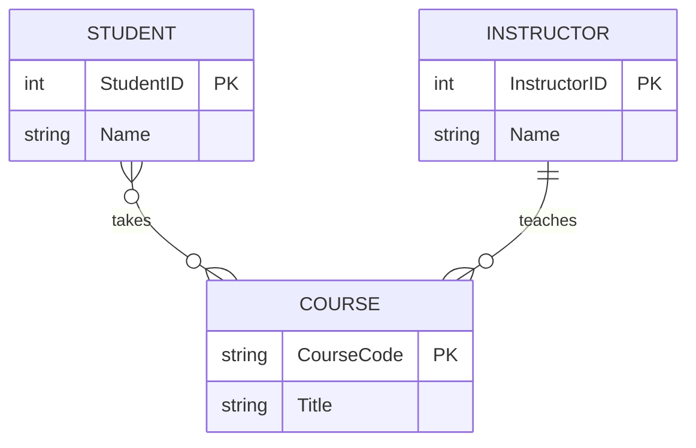

---

## 2.10 Prescriptions-R-X Pharmacy Chain **[10]**

**Asked in:** IT-F24 Q2(A)(2).

**Question (verbatim):**
> The Prescriptions-R-X chain of pharmacies has offered to give you a free life-time supply of medicines if you design its database. Given the rising cost of health care, you agree. Here is the information that you gather.
> 1. Patients are identified by SSN, and their names, addresses, and also ages.
> 2. Doctors are identified by an SSN, for each doctor, the name, specialty and years of experience must be recorded.
> 3. Each pharmaceutical company is identified by name and has a phone number.
> 4. For each drug, the trade name and formula must be recorded. Each drug is sold by a given pharmaceutical company, and the trade name identifies a drug uniquely from among the products of that company. If a pharmaceutical company is deleted, you need not keep track of its products any longer.
> 5. Each pharmacy has a name, address, and phone number.
> 6. Every patient has a primary physician. Every doctor has at least one patient.
> 7. Each pharmacy sells several drugs and has a price for each. A drug could be sold at several pharmacies, and the price could vary from one pharmacy to another.
> 8. Doctors prescribe drugs for patients. A doctor could prescribe one or more drugs for several patients, and a patient could obtain prescriptions from several doctors. Each prescription has a date and a quantity associated with it. You can assume that if a doctor prescribes the same drug for the same patient more than once, only the last such prescription needs to be stored.
> 9. Pharmaceutical company have long-term contracts with pharmacies. A pharmaceutical company can contract with several pharmaceutical companies. For each contract, you have to store a start date, and end date, and the text of the contract.
> 10. Pharmacies appoint a supervisor for each contract. There must always a supervisor for each contract.

**Entities and attributes**

- PATIENT(<u>SSN</u>, Name, Address, Age)
- DOCTOR(<u>SSN</u>, Name, Specialty, YearsExperience)
- PHARMACEUTICAL_COMPANY(<u>CompanyName</u>, Phone)
- DRUG(<u>CompanyName, TradeName</u>, Formula)
- PHARMACY(<u>PharmacyName</u>, Address, Phone)
- CONTRACT(<u>CompanyName, PharmacyName</u>, StartDate, EndDate, ContractText)
- PRESCRIPTION(<u>PatientSSN, DoctorSSN, CompanyName, TradeName</u>, Date, Quantity)
- SUPERVISOR(<u>SupervisorID</u>, Name, Phone)

**Relationships and constraints**

- PATIENT **has primary physician** DOCTOR — M:1; every patient has exactly one primary physician, and every doctor has at least one patient (total participation of PATIENT; total participation of DOCTOR in the relationship).
- DOCTOR **prescribes** DRUG to PATIENT — ternary relationship represented by PRESCRIPTION with Date and Quantity. If the same doctor prescribes the same drug to the same patient more than once, only the latest prescription is stored (so the key includes PatientSSN, DoctorSSN, CompanyName, TradeName, and Date may be updated).
- PHARMACEUTICAL_COMPANY **sells** DRUG — 1:M.
- PHARMACY **sells** DRUG — M:N with Price (a drug can be sold at several pharmacies at different prices).
- PHARMACEUTICAL_COMPANY **contracts with** PHARMACY — M:N with StartDate, EndDate, ContractText.
- PHARMACY **appoints** SUPERVISOR for each contract — each contract has exactly one supervisor; a supervisor may supervise several contracts (1:M from SUPERVISOR to CONTRACT).

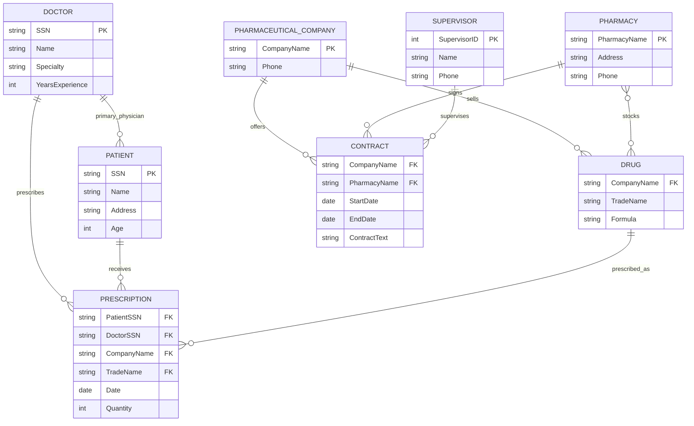

> **Exam tip:** Underline key attributes in the diagram, mark cardinalities (1, N, M) on edges, and use double lines for total participation.

---

# Part B — EER Concepts

## 2.11 Explain specialization and generalization with examples. **[5]**

**Asked in:** IT-F24 Q3(A)(1); CO-F24 Q1(A) (as part of EER); CO-R25 Q1(B)(ii) (generalization); IO-F24 Q2(b)(ii); IC-R26 Q1(b)(ii).

**Questions (verbatim):**
> Discuss specialization and generalization in Extended ER diagram with the help of examples.
>
> Explain Specialization with example.
>
> Explain Generalization with example.
>
> Consider an example of a "Person" in university, An entity that can be either a "Teaching Staff", “Student” or a "Non-Teaching Staff." How to design model this using specialization? What would be the key differences in how you model this using generalization?
>
> Demonstrate how generalization, specialization, and aggregation enhance the basic ER model.

**Specialization (top-down)**

Specialization starts with a general entity (superclass) and creates more specific subclasses based on distinguishing attributes or relationships. It is a **top-down** process.

**Example:** `PERSON` can be specialized into `STUDENT`, `FACULTY` and `STAFF`. All share Name, Address and Phone; each subclass adds its own attributes (Student: Program, GPA; Faculty: Department, Salary).

**Generalization (bottom-up)**

Generalization starts with several specific entity sets and combines their common attributes into a higher-level superclass. It is a **bottom-up** process.

**Example:** `CAR` and `TRUCK` share RegistrationNo, Model and Price; generalize them into `VEHICLE`.

**Key differences**

| Point | Specialization | Generalization |
|---|---|---|
| Direction | Top-down | Bottom-up |
| Starting point | One general entity | Several specific entities |
| Purpose | Add specific attributes/relationships | Remove duplication by extracting common attributes |
| Result | Superclass → subclasses | Subclasses → superclass |
| Example | PERSON → STUDENT, FACULTY | CAR, TRUCK → VEHICLE |

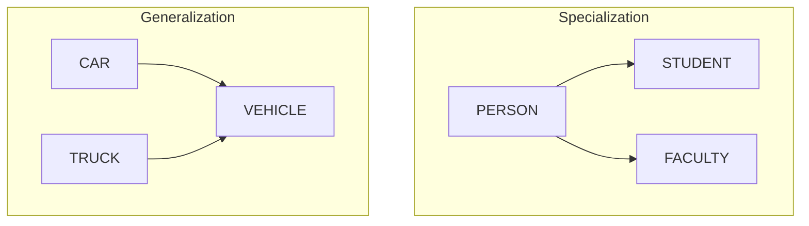

---

## 2.12 Explain aggregation in the EER model with an example. **[5]**

**Asked in:** IC-R26 Q1(b)(ii); CO-B26 Q4(A)(ii) (generalization, specialization, aggregation).

**Question (verbatim):**
> Explain the concept of generalization, specialization and aggregation with the help of real-world scenario.

**Answer**

**Aggregation** treats a relationship (or an entity plus its relationships) as a single higher-level entity so that it can participate in another relationship. It is useful when a relationship itself has a relationship.

**Example:** An `EMPLOYEE` **works_on** a `PROJECT`. A `MANAGER` **monitors** the *works_on* relationship (not just the employee or project individually). The `WORKS_ON` relationship is aggregated into an entity `WORK_ASSIGNMENT`, and `MANAGER` is related to `WORK_ASSIGNMENT` through `MONITORS`.

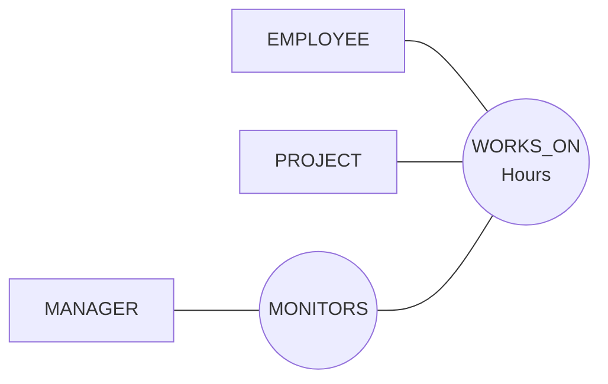

**Why aggregation?** Without it, we cannot express "which manager monitors which employee-project assignment"; a ternary relationship could also model it, but aggregation makes the intent clearer.

---

## 2.13 Discuss constraints on subclasses in the EER model. **[5–7]**

**Asked in:** CO-F24 Q1(B)(ii) **[5]**; IT-F25 Q4(A)(2) (disjointness); IT-R25 Q3(A)(1) (specialization lattice and union type); IT-R26 Q4(A)(2) (overlapping constraint).

**Questions (verbatim):**
> Discuss contraint on subclasses in enhanched ER model with suitable example.
>
> Explain Disjointness constraint used in subclass and superclass relationships.
>
> Explain Overlapping constraint used while creating subclasses from given superclass with example.
>
> Discuss specialization Lattice and union type with the help of an example.

### (a) Participation/completeness constraint

- **Total specialization/generalization:** every entity of the superclass must belong to at least one subclass. Shown by a **double line**.
- **Partial specialization/generalization:** some superclass entities may not belong to any subclass. Shown by a **single line**.

**Example:** Every `EMPLOYEE` must be either `FACULTY` or `STAFF` → total. Only some `PERSON` are `STUDENT` → partial.

### (b) Disjointness constraint

- **Disjoint (`d`):** an entity can belong to **at most one** subclass. The subclasses are mutually exclusive.
- **Overlapping (`o`):** an entity can belong to **more than one** subclass.

**Example (disjoint):** A bank account is either `SAVINGS` or `CURRENT`, not both.
**Example (overlapping):** A person can be both a `STUDENT` and an `EMPLOYEE`.

### (c) Specialization hierarchy vs lattice

- **Hierarchy:** each subclass has only one superclass (single inheritance).
- **Lattice:** a subclass can have more than one superclass (multiple inheritance). Example: `TEACHING_ASSISTANT` is both `STUDENT` and `EMPLOYEE`.

### (d) Union type

A **union type** (category) is a subclass whose members come from the union of two or more superclasses. Example: `OWNER` is a union of `PERSON` and `COMPANY`; an owner can be a person or a company.

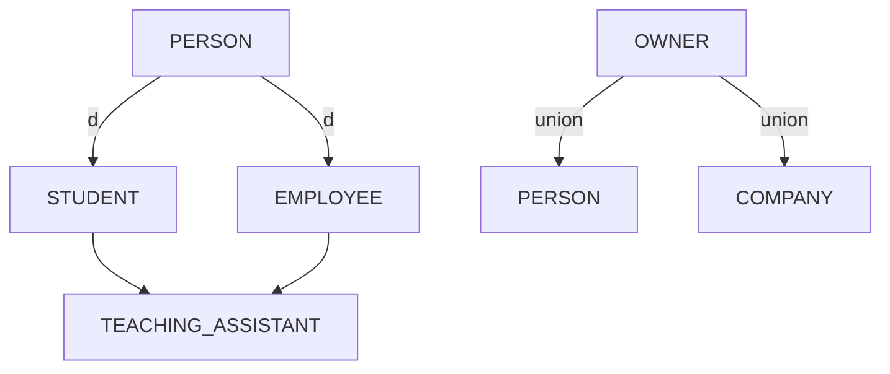

---

## 2.14 Explain total and partial participation, and their effect on ER design. **[7]**

**Asked in:** IO-F24 Q2(b)(i) **[7]**.

**Question (verbatim):**
> Define total and partial participation in relationship constraints, and explain how they affect the design of an ER diagram.

**Answer**

**Participation constraint** specifies whether every entity of an entity set must participate in a relationship.

- **Total participation (mandatory):** every entity must participate. Drawn with a **double line**. Example: every `LOAN` must be associated with a `BORROWER`; a loan cannot exist without a borrower.
- **Partial participation (optional):** only some entities participate. Drawn with a **single line**. Example: only some `EMPLOYEES` are managers; an employee need not manage anyone.

**Effect on design**

- Total participation often leads to a **NOT NULL foreign key** or a merged relation; the relationship becomes mandatory in the schema.
- Partial participation leads to a **nullable foreign key** or a separate relationship relation; the relationship is optional.
- Total participation can justify combining a weak entity/relationship into the owner relation, while partial participation usually requires a separate table.
- Cardinality + participation together determine the exact mapping (1:1, 1:N, M:N) and the placement of foreign keys.

---

## 2.15 Explain the types of keys in a relational database. **[5–10]**

**Asked in:** IC-R26 Q1(b)(i); CO-B26 Q4(A)(i); CO-F24 style short question.

**Questions (verbatim):**
> Apply your understanding of Super Keys, Candidate Keys, Primary Keys, Foreign Keys, and Surrogate Keys by using a real-world example of a database of your choice.
>
> Explain the various types of keys in relational database systems. Provide examples to illustrate the use of each type of key in a database schema.

**Answer**

Consider `STUDENT(StudentID, Email, Name, DeptID)` where `StudentID` is the primary key and `Email` is unique.

| Key | Definition | Example |
|---|---|---|
| **Super key** | Any set of attributes that uniquely identifies a tuple | {StudentID}, {StudentID, Name}, {Email}, {Email, Name} |
| **Candidate key** | A minimal super key (no unnecessary attribute) | {StudentID}, {Email} |
| **Primary key** | The candidate key chosen to identify tuples | StudentID |
| **Alternate key** | A candidate key not chosen as primary | Email |
| **Composite key** | A key made of two or more attributes | (StudentID, CourseID) in ENROLLMENT |
| **Foreign key** | Attribute(s) referencing the primary key of another relation | DeptID → DEPARTMENT(DeptID) |
| **Surrogate key** | System-generated, meaningless identifier | Auto-increment StudentID |
| **Partial key** | Attribute that distinguishes weak entities within an owner | DependentName in DEPENDENT |

**Example schema**

```sql
DEPARTMENT(DeptID PRIMARY KEY, DeptName);
STUDENT(StudentID PRIMARY KEY, Email UNIQUE, Name, DeptID,
        FOREIGN KEY (DeptID) REFERENCES DEPARTMENT(DeptID));
ENROLLMENT(StudentID, CourseID, Grade,
           PRIMARY KEY (StudentID, CourseID),
           FOREIGN KEY (StudentID) REFERENCES STUDENT(StudentID),
           FOREIGN KEY (CourseID) REFERENCES COURSE(CourseID));
```

Here `(StudentID, CourseID)` is a composite primary key; `DeptID` is a foreign key; `Email` is an alternate key; `StudentID` could be a surrogate key if generated by the system.

---

# Part C — Mapping ER/EER to the Relational Model

## 2.16 Explain the steps for mapping an ER/EER model to the relational model. **[10]**

**Asked in:** IT-R25 Q2(A)(2); CO-F24 Q4(A)(ii); CO-R25 Q4(A)(ii); IT-F25 Q2(A)(I); AI-R26 Q1(A)(ii); CO-R26 Q6(ii).

**Questions (verbatim):**
> Convert following ER diagram into Relational model. Provide a clear justification for each relation created.
>
> Convert the Following ER Diagram to its Equivalent Relational model. Discuss the steps applied.
>
> Convert the following EER into Relational Model.
>
> Convert the following EER to its Relational Model (use any one hierarchy for multilevel mapping).
>
> Convert the following ER into Relational Model including all the steps of conversion.

**Answer — standard mapping algorithm**

1. **Strong entity set → relation**
   - Create a relation with all simple attributes.
   - Flatten composite attributes into their simple components.
   - Choose one candidate key as the primary key.

2. **Weak entity set → relation**
   - Create a relation with the weak entity's attributes.
   - Add the owner entity's primary key as a foreign key.
   - The primary key is `(owner PK, partial key)`.

3. **1:1 relationship**
   - Option A: add the primary key of one entity as a foreign key in the other (prefer the side with total participation).
   - Option B: merge the two relations if both participate totally.
   - Add a `UNIQUE` constraint on the foreign key.

4. **1:N relationship**
   - Add the primary key of the "1" side as a foreign key in the "N" side.
   - Include any relationship attributes in the "N" relation.

5. **M:N relationship**
   - Create a new relation with the primary keys of both entities as foreign keys.
   - The composite of these keys is the primary key.
   - Add relationship attributes.

6. **Multi-valued attribute → relation**
   - Create a separate relation with the owner's primary key and the attribute.
   - Primary key = `(owner PK, attribute)`.

7. **Ternary or higher-degree relationship → relation**
   - Create a relation with the primary keys of all participating entities.
   - Add relationship attributes; the composite key is the primary key.

8. **Specialization/generalization**
   - **Single-table (ER-style):** one relation with all attributes + a type discriminator; nulls for inapplicable attributes.
   - **Table-per-subclass:** superclass relation + one relation per subclass with the superclass PK as FK.
   - **Table-per-hierarchy:** one relation per subclass containing all inherited + specific attributes (duplicates common attributes).
   - Choose based on total/partial and disjoint/overlapping constraints.

9. **Aggregation**
   - Map the aggregated relationship as a separate relation, then relate it to the higher-level entity.

**Worked example**

ER: `EMPLOYEE(EmpID, Name, Bdate, Address, Sex, Salary)`, `DEPARTMENT(DeptNo, DName, MgrSSN)`, `PROJECT(ProjNo, PName, Location)`, `WORKS_ON(Hours)`, `DEPENDENT(Name, Sex, Bdate, Relationship)`, multi-valued `DLocation`.

Relational schema:

```text
EMPLOYEE(EmpID PK, Name, Bdate, Address, Sex, Salary, SuperSSN FK→EMPLOYEE, DeptNo FK→DEPARTMENT)
DEPARTMENT(DeptNo PK, DName, MgrSSN FK→EMPLOYEE)
DEPT_LOCATIONS(DeptNo FK, DLocation, PK(DeptNo, DLocation))
PROJECT(ProjNo PK, PName, Location, DeptNo FK→DEPARTMENT)
WORKS_ON(EmpID FK, ProjNo FK, Hours, PK(EmpID, ProjNo))
DEPENDENT(EmpID FK, DependentName, Sex, Bdate, Relationship, PK(EmpID, DependentName))
```

**Justification:** 1:N (department–employee, department–project) puts the FK on the N side; M:N (employee–project) needs `WORKS_ON`; multi-valued location needs `DEPT_LOCATIONS`; weak entity `DEPENDENT` gets a composite key.

---

## 2.17 Convert an EER diagram with specialization/generalization to the relational model. **[10]**

**Asked in:** CO-R25 Q4(A)(ii); CO-R26 Q6(ii); IT-F25 Q2(A)(I) (ER → relational).

**Answer**

Suppose the EER has superclass `PERSON(PersonID, Name, Address)` and subclasses `STUDENT(PersonID, GPA, Program)` and `EMPLOYEE(PersonID, Salary, DeptID)`, with total, disjoint specialization.

**Option 1 — Single table (one relation for the whole hierarchy)**

```text
PERSON(PersonID PK, Name, Address, Type, GPA, Program, Salary, DeptID)
```

- `Type` discriminates student/employee.
- Simple, but many NULLs and weak integrity for subclass-specific attributes.

**Option 2 — Table per subclass (recommended for total specialization)**

```text
PERSON(PersonID PK, Name, Address)
STUDENT(PersonID PK FK→PERSON, GPA, Program)
EMPLOYEE(PersonID PK FK→PERSON, Salary, DeptID FK→DEPARTMENT)
```

- No NULLs; each subclass relation contains only relevant attributes.
- Requires a join to get all attributes; total specialization guarantees every PERSON row has a matching subclass row.

**Option 3 — Table per hierarchy (one table per subclass with all attributes)**

```text
STUDENT(PersonID PK, Name, Address, GPA, Program)
EMPLOYEE(PersonID PK, Name, Address, Salary, DeptID)
```

- No join needed for a subclass query, but common attributes are duplicated.

**For overlapping specialization:** use Option 2 with a separate table per subclass; a person can appear in multiple subclass tables. For **partial** specialization, Option 2 still works but some PERSON rows have no subclass row.

**Mapping steps to write in the exam:** (1) map superclass, (2) map each subclass with the superclass PK as FK, (3) add subclass-specific attributes, (4) enforce total/partial and disjoint/overlapping constraints in the schema or application.

---

# Part D — Relational Algebra

**Notation:** `π` projection, `σ` selection, `⋈` natural join, `×` Cartesian product, `∪` union, `−` set difference, `ρ` rename, `γ` aggregation.

## 2.18 Suppliers / Parts / Catalog **[5]**

**Asked in:** IT-F24 Q2(B).

**Question (verbatim):**
> Consider the following relational database schema:
> Suppliers(sID, sName, address)
> Parts(pID, pName, colour)
> Catalog(sID, pID, price)
> Write relational algebra queries for the following.
> 1. Find the names of all red parts
> 2. Find all prices for parts that are red or green.
> 3. Find the names of all suppliers who supply a part that is red or green.

Schema:
```text
Suppliers(sID, sName, address)
Parts(pID, pName, colour)
Catalog(sID, pID, price)
```

**Queries**

1. **Names of all red parts**
```text
π_pName(σ_colour = 'red'(Parts))
```

2. **All prices for parts that are red or green**
```text
π_price(σ_colour = 'red' ∨ colour = 'green'(Parts) ⋈ Catalog)
```
(Join on `pID`.)

3. **Names of all suppliers who supply a part that is red or green**
```text
π_sName(Suppliers ⋈ Catalog ⋈ σ_colour = 'red' ∨ colour = 'green'(Parts))
```
(Join `Suppliers` with `Catalog` on `sID`, and `Catalog` with `Parts` on `pID`.)

---

## 2.19 Passenger / Agency / Flight / Booking **[5]**

**Asked in:** IT-R25 Q2(B).

**Question (verbatim):**
> Consider the following relational database schema consisting of the four relations:
> passenger ( pid, pname, pgender, pcity)
> agency ( aid, aname, acity)
> flight (fid, fdate, time, src, dest)
> booking (pid, aid, fid, fdate)
> Write relational algebra queries for the following.
> 1. Find complete details of all flights to New Delhi.
> 2. Find the passenger names for passengers who have bookings on at least one flight.
> 3. Find the passenger names for those who do not have any bookings in any flights.

Schema:
```text
passenger(pid, pname, pgender, pcity)
agency(aid, aname, acity)
flight(fid, fdate, time, src, dest)
booking(pid, aid, fid, fdate)
```

**Queries**

1. **Complete details of all flights to New Delhi**
```text
σ_dest = 'New Delhi'(flight)
```

2. **Passenger names for passengers who have bookings on at least one flight**
```text
π_pname(passenger ⋈ booking)
```

3. **Passenger names for those who do not have any bookings in any flight**
```text
π_pname(passenger) − π_pname(passenger ⋈ booking)
```

---

## 2.20 Patient / Doctor / Appointment / Prescription **[5]**

**Asked in:** IT-F25 Q2(B).

**Question (verbatim):**
> Consider the following relational database schema:
> patient ( pid, pname, pgender, pcity )
> doctor ( did, dname, specialty )
> appointment ( aid, pid, did, adate )
> prescription ( prid, aid, med, qty )
> Write relational algebra queries for the following.
> 1. Find patients who have appointments with doctors of the ‘Cardiology’ specialty.
> 2. List appointment IDs for appointments scheduled after ‘2024-06-01’.
> 3. Find patients who have an appointment but were not prescribed any medicine.

Schema:
```text
patient(pid, pname, pgender, pcity)
doctor(did, dname, specialty)
appointment(aid, pid, did, adate)
prescription(prid, aid, med, qty)
```

**Queries**

1. **Patients who have appointments with doctors of the ‘Cardiology’ specialty**
```text
π_pname(patient ⋈ appointment ⋈ σ_specialty = 'Cardiology'(doctor))
```

2. **Appointment IDs for appointments scheduled after ‘2024-06-01’**
```text
π_aid(σ_adate > '2024-06-01'(appointment))
```

3. **Patients who have an appointment but were not prescribed any medicine**
```text
π_pname(patient ⋈ appointment)
−
π_pname(patient ⋈ appointment ⋈ prescription)
```

---

## 2.21 Customer / Branch / Account / Transaction **[10]**

**Asked in:** IT-R26 Q2(B).

**Question (verbatim):**
> Consider the following relational database schema:
> customer ( cid, cname, cgender, ccity )
> branch ( bid, bname, bcity )
> account ( aid, cid, bid, atype )
> transaction ( tid, aid, tdate, amount )
> Write relational algebra queries for the following.
> 1. Find the customer names for customers who have made at least one transaction.
> 2. Find the customer names for those who have not made any transactions.
> 3. Find complete details of all transactions with amounts greater than 100000.

Schema:
```text
customer(cid, cname, cgender, ccity)
branch(bid, bname, bcity)
account(aid, cid, bid, atype)
transaction(tid, aid, tdate, amount)
```

**Queries**

1. **Customer names for customers who have made at least one transaction**
```text
π_cname(customer ⋈ account ⋈ transaction)
```

2. **Customer names for those who have not made any transactions**
```text
π_cname(customer) − π_cname(customer ⋈ account ⋈ transaction)
```

3. **Complete details of all transactions with amounts greater than 100000**
```text
σ_amount > 100000(transaction)
```

If "complete details" means customer + account + transaction details:
```text
π_customer.*, account.*, transaction.*(σ_amount > 100000(transaction) ⋈ account ⋈ customer)
```

---

## 2.22 Exact ER/EER-to-relational mappings from past papers

> The exact question wording for these diagrams is listed in **2.16**. Each subsection below is the mapping answer for that paper's diagram.

The general algorithm is in 2.16. Below are the specific diagrams that appeared in the papers, mapped relation by relation.

### (a) IT-R25 Q2(A)(2) — Company / Staff / Child / Wife / Phone / Task

The diagram models a company, its staff, staff families and tasks. A staff member works for one company, may have one wife, many children and many phone numbers, and performs many tasks.

```text
COMPANY(cname PK, ...)

STAFF(ID PK, dob, address, since, name,
      WifeID FK→WIFE, Company_cname FK→COMPANY)

WIFE(WifeID PK, name)          -- 1:1 with STAFF

CHILD(StaffID FK→STAFF, name, ...,
      PK(StaffID, name))       -- weak entity, partial key name

PHONE(StaffID FK→STAFF, phoneNumber,
      PK(StaffID, phoneNumber)) -- multi-valued attribute

TASK(description PK, ...)

PERFORM(StaffID FK→STAFF, description FK→TASK,
        PK(StaffID, description)) -- M:N relationship
```

**Justification:** 1:N company–staff puts `Company_cname` in STAFF; 1:1 wife–staff puts `WifeID` in STAFF (or `StaffID` in WIFE); the weak entity CHILD gets the owner key; the multi-valued phone becomes its own relation; the M:N task assignment becomes PERFORM.

### (b) CO-F24 Q4(A)(ii) — Bank / Person / Company / Owner / Vehicle

The EER has `OWNER` as a **union type** of `PERSON` and `COMPANY`; `REGISTERED_VEHICLE` is a union of `CAR` and `TRUCK`; `OWNS` is M:N with `Lien_or_regular` and `Purchase_date`.

```text
BANK(Bname PK, Baddress)

PERSON(Ssn PK, Name, Address, Driver_license_no)
COMPANY(Cname PK, Caddress)

-- Union type OWNER: one table with a type discriminator and exclusive FKs
OWNER(OwnerID PK,
      Person_Ssn FK→PERSON,
      Company_Cname FK→COMPANY,
      CHECK (Person_Ssn IS NOT NULL AND Company_Cname IS NULL
          OR Person_Ssn IS NULL AND Company_Cname IS NOT NULL))

CAR(License_plate_no PK, Vehicle_id, Cstyle, Cmake, Cyear, Cmodel)
TRUCK(License_plate_no PK, Vehicle_id, Tonnage, Tmake, Tyear, Tmodel)

OWNS(OwnerID FK→OWNER, License_plate_no,
     Lien_or_regular, Purchase_date,
     PK(OwnerID, License_plate_no))
```

**Justification:** A union type cannot be a normal FK, so `OWNER` uses either (i) one table with a type discriminator + exclusive FKs, or (ii) two tables `PERSON_OWNER(Ssn)` and `COMPANY_OWNER(Cname)` plus a shared `OWNER` key. `CAR` and `TRUCK` share the `License_plate_no` key domain; `OWNS` is the M:N relationship with its attributes. If the diagram relates `BANK` to `OWNER`, add `Bank_Name` to `OWNER`/`OWNS`.

### (c) CO-R25 Q4(A)(ii) — Person / Employee / Student hierarchy

The EER has `PERSON` with an **overlapping** specialization (`o`) into `EMPLOYEE`, `ALUMNUS` and `STUDENT`; `EMPLOYEE` is further specialized (disjoint, `d`) into `STAFF` and `FACULTY`; `STUDENT` into `GRADUATE_STUDENT` and `UNDERGRADUATE_STUDENT`; `STUDENT_ASSISTANT` into `RESEARCH_ASSISTANT` and `TEACHING_ASSISTANT`.

**Recommended mapping — table per subclass with FK to the superclass:**

```text
PERSON(Ssn PK, Name, Sex, Address, Birth_date)

EMPLOYEE(Ssn PK FK→PERSON, Salary)
ALUMNUS(Ssn PK FK→PERSON, Degrees, Year, Degree, Major)
STUDENT(Ssn PK FK→PERSON, Major_dept)

STAFF(Ssn PK FK→EMPLOYEE, Position)
FACULTY(Ssn PK FK→EMPLOYEE, Rank)

STUDENT_ASSISTANT(Ssn PK FK→STUDENT, Percent_time)
GRADUATE_STUDENT(Ssn PK FK→STUDENT, Degree_program)
UNDERGRADUATE_STUDENT(Ssn PK FK→STUDENT, Class)

RESEARCH_ASSISTANT(Ssn PK FK→STUDENT_ASSISTANT, Project)
TEACHING_ASSISTANT(Ssn PK FK→STUDENT_ASSISTANT, Course)
```

Because the PERSON specialization is **overlapping**, a person can appear in more than one subclass table (e.g., both EMPLOYEE and ALUMNUS). The `Ssn` PK/FK in every subclass enforces the "is-a" link. The EMPLOYEE and STUDENT specializations are **disjoint**, so a person cannot be both STAFF and FACULTY, or both GRADUATE and UNDERGRADUATE.

**Alternative — single table:** `PERSON(Ssn, Name, Sex, Address, Birth_date, Type, Salary, Major_dept, Position, Rank, Percent_time, Degree_program, Class, ...)` with a type discriminator. Simpler queries but many NULLs.

### (d) IT-F25 Q2(A)(I) — Hotel Management

The ER diagram has `Guest`, `Invoice`, `Payment`, `Comments_Complains`, `Facilities`, `Room` and `Reservation`, with M:N relationships for reservation–room and reservation–facilities.

```text
GUEST(S_ID PK, F_Name, L_Name, M_Name, NIC_NO,
      Gender, TEL, Country, Address, Reg_Date)

INVOICE(Invoice_ID PK, Date, VAT, TAX,
        Tot_F_Charge, Tot_A_Charge, Tot_O_Charge,
        Net_Amount, S_ID FK→GUEST)

PAYMENT(P_ID PK, Date, Tot_Amt, Net_Amount,
        A_Payment, Invoice_ID FK→INVOICE)

COMMENTS_COMPLAINS(C_ID PK, Type, Description, Date,
                   S_ID FK→GUEST)

FACILITIES(F_ID PK, Type, Charge, Description, Date, Status)
ROOM(R_ID PK, Type, Charge, Status)

RESERVATION(Res_ID PK, Res_Date, No_of_Nights,
            No_of_Rooms, S_ID FK→GUEST)

RESERVATION_ROOM(Res_ID FK→RESERVATION, R_ID FK→ROOM,
                 PK(Res_ID, R_ID))

RESERVATION_FACILITIES(Res_ID FK→RESERVATION, F_ID FK→FACILITIES,
                       PK(Res_ID, F_ID))
```

**Justification:** `Guest` is the owner of invoices, complaints and reservations (1:N FKs). The M:N reservation–room and reservation–facilities links become separate relations. `Payment` is 1:N with `Invoice`.

### (e) AI-R26 Q1(A)(ii) — Airline Database

The ER diagram has `AIRPORT`, `FLIGHT_LEG`, `FLIGHT`, `AIRPLANE_TYPE`, `AIRPLANE`, `FARE`, `LEG_INSTANCE`, `SEAT` and `RESERVATION`.

```text
AIRPORT(Airport_code PK, City, State, Name)
AIRPLANE_TYPE(Type_name PK, Max_seats, Company)
AIRPLANE(Airplane_id PK, Total_no_of_seats, Type_name FK→AIRPLANE_TYPE)

FLIGHT(Airline, Number, Weekdays, Restrictions,
       PK(Airline, Number))

FLIGHT_LEG(Airline, Number, Leg_no,
           Departure_airport FK→AIRPORT,
           Arrival_airport FK→AIRPORT,
           Scheduled_dep_time, Scheduled_arr_time,
           PK(Airline, Number, Leg_no))

LEG_INSTANCE(Airline, Number, Leg_no, Date,
             No_of_avail_seats, Airplane_id FK→AIRPLANE,
             PK(Airline, Number, Leg_no, Date))

FARE(Airline, Number, Code, Amount, Restrictions,
     PK(Airline, Number, Code))

SEAT(Airline, Number, Leg_no, Date, Seat_no,
     Customer_name, Cphone,
     PK(Airline, Number, Leg_no, Date, Seat_no))

CAN_LAND(Type_name FK→AIRPLANE_TYPE, Airport_code FK→AIRPORT,
         PK(Type_name, Airport_code))
```

**Justification:** `FLIGHT_LEG` is a weak entity of `FLIGHT` (composite key includes airline + number + leg number). `LEG_INSTANCE` is a weak entity of `FLIGHT_LEG` (adds Date). `SEAT` is a weak entity of `LEG_INSTANCE`. `CAN_LAND` is the M:N relationship between airplane type and airport. `FARE` is identified by flight + fare code. If `Weekdays` or `Restrictions` are multi-valued, create `FLIGHT_DAYS(Airline, Number, Weekday)` and `FLIGHT_RESTRICTIONS(Airline, Number, Restriction)`.

### (f) CO-R26 Q6(ii) — Company Database (classic Elmasri/Navathe)

The diagram has `EMPLOYEE`, `DEPARTMENT`, `PROJECT`, `DEPENDENT`, with `WORKS_FOR`, `MANAGES`, `WORKS_ON`, `CONTROLS`, `SUPERVISION` and `DEPENDENTS_OF`.

```text
EMPLOYEE(Ssn PK, Fname, Minit, Lname, Bdate, Name,
         Address, Sex, Salary,
         Super_ssn FK→EMPLOYEE,
         Dno FK→DEPARTMENT)

DEPARTMENT(Dnumber PK, Dname,
           Mgr_ssn FK→EMPLOYEE, Mgr_start_date)

DEPT_LOCATIONS(Dnumber FK→DEPARTMENT, Dlocation,
               PK(Dnumber, Dlocation))

PROJECT(Pnumber PK, Pname, Plocation,
        Dnum FK→DEPARTMENT)

WORKS_ON(Essn FK→EMPLOYEE, Pno FK→PROJECT, Hours,
         PK(Essn, Pno))

DEPENDENT(Essn FK→EMPLOYEE, Dependent_name, Sex,
          Bdate, Relationship,
          PK(Essn, Dependent_name))
```

**Justification:** `WORKS_FOR` is 1:N → `Dno` in EMPLOYEE. `MANAGES` is 1:1 → `Mgr_ssn` in DEPARTMENT. `CONTROLS` is 1:N → `Dnum` in PROJECT. `WORKS_ON` is M:N → separate relation with `Hours`. `SUPERVISION` is 1:N recursive → `Super_ssn`. `DEPENDENTS_OF` is a weak entity → composite key `(Essn, Dependent_name)`. `Locations` is multi-valued → `DEPT_LOCATIONS`.

---

## Unit 2 — quick revision checklist

- [ ] Draw any 5 of the ER scenarios from memory (library, hospital, banking, hotel, airline)
- [ ] Specialization vs generalization (direction, purpose, example)
- [ ] Aggregation with `WORKS_ON`/`MONITORS` example
- [ ] Total/partial and disjoint/overlapping constraints, `d`/`o` notation
- [ ] Specialization hierarchy vs lattice vs union type
- [ ] Super/candidate/primary/alternate/composite/foreign/surrogate keys
- [ ] 9-step ER-to-relational mapping algorithm
- [ ] 1:1, 1:N, M:N, multivalued, weak entity, specialization mapping
- [ ] Relational algebra: σ, π, ⋈, −, ∪, ÷; solve the four query sets
