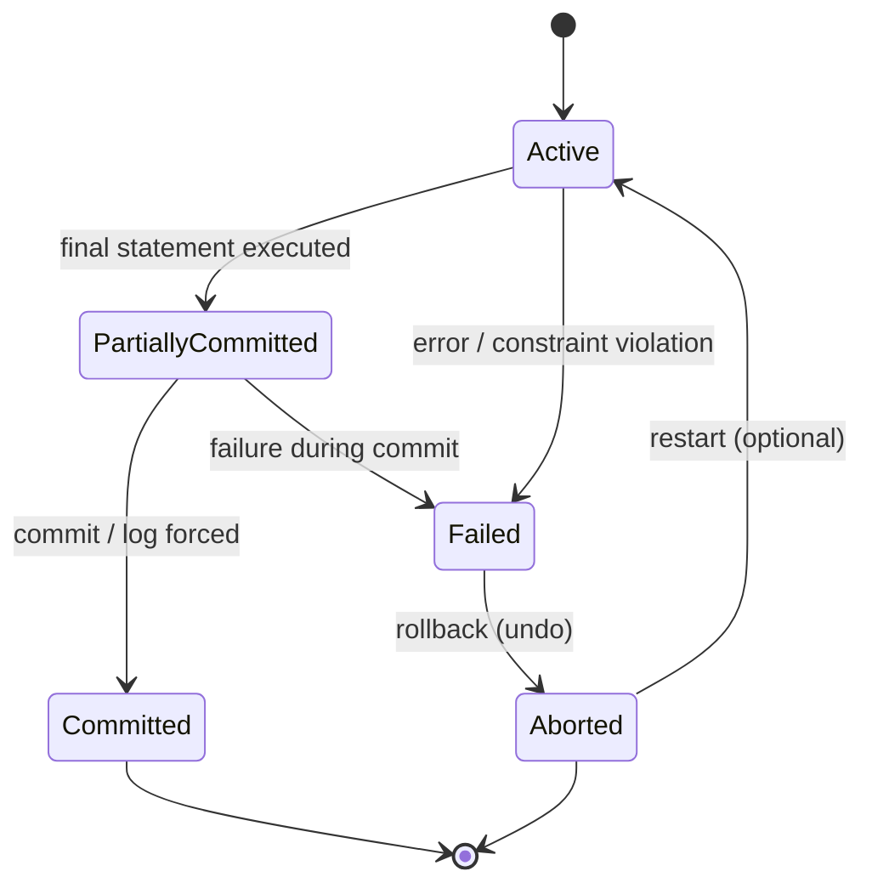

# Unit 5 — Transaction Management and Recovery

> **Syllabus (DJS23IPC202, 8 hrs):** Transaction concept, ACID properties, transaction states, implementation of atomicity and durability, concurrent executions, serializability, concurrency control protocols — lock-based, timestamp-based, validation-based; deadlock handling; recovery system — failure classification, log-based recovery, shadow paging.
>
> **Past-paper coverage:** ACID, states, conflict/view serializability (8 schedules), precedence graphs, 2PL/strict 2PL, timestamp ordering (3 schedules), validation-based control, deadlock prevention/detection, log-based recovery (immediate/deferred), shadow paging vs ARIES, failure classification, COMMIT/ROLLBACK.

**Source codes**

| Code | Paper |
|---|---|
| IT-F24 | IT Final 2024-25 (Dec 2024) |
| IT-R25 | IT Re-Exam 2024-25 (Mar 2025) |
| CO-F24 | Comp Final 2024-25 (Dec 2024) |
| CO-R25 | Comp Re-Exam 2024-25 (Mar 2025) |
| IO-F24 | IOT Final 2024-25 (Dec 2024) |
| DS-F24 | DS Final 2024-25 (Dec 2024) |
| DS-R25 | DS Re-Exam 2024-25 (Mar 2025) |
| IT-F25 | IT Final 2025-26 (Dec 2025) |
| IT-R26 | IT Re-Exam 2025-26 (Mar 2026) |
| AI-R26 | AIDS Re-Exam 2025-26 (Mar 2026) |
| IC-R26 | CSE (ICB) Re-Exam 2025-26 (Mar 2026) |
| CO-R26 | Comp Re-Exam 2024-25 batch (Mar 2026) |
| CO-B26 | 2023-24 Backlog Re-Exam (Mar 2026) |

---

## 5.1 Transaction concept and ACID properties **[5–10]**

**Asked in:** IT-F24 Q4(A)(2) (atomicity + consistency) **[5]**; IT-R25 Q4(A)(2) (transaction + states) **[5]**; IT-R26 Q3(A)(1) (properties with example) **[10]**; CO-R26 Q5(ii) (states) **[5]**; IT-F25 Q3(A)(1) (state diagram) **[5]**.

**Questions (verbatim):**
> Define transaction. Discuss the properties of a transaction with the help of an example.
>
> Discuss Atomicity and Consistency property of a transaction with suitable example.
>
> What is a Transaction? Discuss the various states of a transaction.
>
> What are the different states of a transaction in SQL? Draw and Explain it in Detail.
>
> Draw and explain the transaction state diagram.

**Answer**

A **transaction** is a logical unit of database work that reads and/or updates data items. It must either complete entirely or have no effect at all.

**ACID properties**

| Property | Meaning | Example |
|---|---|---|
| **Atomicity** | All operations or none; failures roll back partial work | Transfer ₹500 from A to B: if debit succeeds but credit fails, undo the debit |
| **Consistency** | A transaction moves the database from one valid state to another, preserving constraints | Total balance A+B remains unchanged after a transfer |
| **Isolation** | Concurrent transactions do not see each other's uncommitted changes; result equivalent to a serial order | Another user cannot see the ₹500 debit until the transfer commits |
| **Durability** | Once committed, changes survive crashes | After `COMMIT`, the new balances are on stable storage |

**Atomicity & consistency example (bank transfer)**

Initial: A = 2000, B = 1000. Transfer ₹500 from A to B.
1. Read A, A = A − 500 → 1500.
2. Read B, B = B + 500 → 1500.
3. Write A, write B, commit.

If the system crashes after step 1, atomicity requires undoing the debit, restoring A = 2000. If both writes complete, consistency requires A + B = 3000 before and after. A constraint such as `balance >= 0` must also hold.

**Transaction states**



1. **Active** — executing read/write operations.
2. **Partially committed** — final statement executed, but changes may not yet be on disk.
3. **Committed** — changes are permanently stored; cannot roll back.
4. **Failed** — normal execution cannot continue (error, crash, constraint violation).
5. **Aborted** — changes rolled back; transaction may restart or be killed.

**Implementation of atomicity and durability**

- **Logging / write-ahead logging (WAL):** before modifying a data item, write a log record containing the transaction ID, data item, old value and new value. On commit, force the commit record to stable storage. On recovery, redo committed transactions and undo uncommitted ones.
- **Shadow paging:** maintain a shadow page table; updates go to new pages; commit atomically switches the page table pointer; abort discards the new pages.
- **Checkpoints:** periodically flush dirty pages and write a checkpoint record to shorten recovery.

---

## 5.2 Serializability — conflict and view **[5–10]**

**Asked in:** IT-R25 Q1(A)(1); IT-F25 Q1(A)(I); AI-R26 Q2(B)(i); IT-R26 Q1(A)(I); CO-R25 Q3(A)(i); CO-B26 Q2(A); DS-R25 Q3(A); IO-F24 Q4(b)(i) (importance).

**Questions (verbatim):**
> Discuss the term conflict Serializability with example. Create a precedence graph to check whether given schedule S is serializable or not?
>
> Explain View Serializability? Check whether the given schedule S is view serializable or not.
>
> What is serializability, and why is it an important concept in concurrent transaction execution?
>
> Define serializability in database transactions. Analyze how enforcing serializability ensures correctness in concurrent executions.

**Answer**

A **schedule** is an ordering of the operations of concurrent transactions. A schedule is **serializable** if its effect is equivalent to some serial execution of the same transactions.

### Conflict serializability

Two operations **conflict** if:
1. They belong to different transactions,
2. They access the same data item, and
3. At least one is a write.

Conflicts: read–write, write–read, write–write.

**Precedence graph (serialization graph)**

- One node per transaction.
- Edge `Ti → Tj` if an operation of Ti conflicts with a later operation of Tj.
- The schedule is **conflict serializable** iff the graph has **no cycle**.
- A topological order of the graph gives an equivalent serial schedule.

### View serializability

Schedules S1 and S2 are **view equivalent** if:
1. They read the same initial values (same initial reads).
2. They produce the same final writes.
3. Each read in S1 sees the same write as the corresponding read in S2 (same read-from relationships).

A schedule is **view serializable** if it is view equivalent to some serial schedule. Every conflict-serializable schedule is view serializable, but the converse is not true (blind writes can make a non-conflict schedule view serializable).

---

## 5.3 Solved serializability schedules

## Schedule 1 — IT-F24 Q1(A)(1) **[10]**

**Question (verbatim):**
> Consider the following schedule:
> w1(A), r2(A), w1(B), w3(C), r2(C), r4(B), w2(D), w4(E), r5(D), w5(E).
> Analyze whether the schedule is conflict serializable or not. If yes, Write the equivalent serial schedule. Also check if schedule is view serializable or not.

**Given**

```text
w1(A), r2(A), w1(B), w3(C), r2(C), r4(B), w2(D), w4(E), r5(D), w5(E)
```

**Precedence graph**

| Conflict | Edge |
|---|---|
| `w1(A)` before `r2(A)` | T1 → T2 |
| `w1(B)` before `r4(B)` | T1 → T4 |
| `w3(C)` before `r2(C)` | T3 → T2 |
| `w2(D)` before `r5(D)` | T2 → T5 |
| `w4(E)` before `w5(E)` | T4 → T5 |

The graph is acyclic (`T1 → T2 → T5`, `T1 → T4 → T5`, `T3 → T2`).

**Conflict serializable?** Yes.
**Equivalent serial schedule:** `T1 → T3 → T4 → T2 → T5` (also `T1 → T4 → T3 → T2 → T5`).

**View serializable?** Yes — conflict serializability implies view serializability. Check: initial reads are preserved (T2 reads T1's A, T4 reads T1's B, T2 reads T3's C, T5 reads T2's D, T5 reads T4's E); final writes are A←T1, B←T1, C←T3, D←T2, E←T5, which match the serial order.

---

## Schedule 2 — IT-R25 Q1(A)(1) **[10]**

**Question (verbatim):**
> Discuss the term conflict Serializability with example. Create a precedence graph to check whether given schedule S is serializable or not?
> S: r1(x), r2(z), r1(z), r3(x), r3(y), w1(x), w3(y), r2(y), w2(z), w2(y).
> Also check for view serializability. Write the equivalent serial schedule.

**Given**

```text
r1(x), r2(z), r1(z), r3(x), r3(y), w1(x), w3(y), r2(y), w2(z), w2(y)
```

**Precedence graph**

| Conflict | Edge |
|---|---|
| `r3(x)` before `w1(x)` | T3 → T1 |
| `r1(z)` before `w2(z)` | T1 → T2 |
| `w3(y)` before `r2(y)` | T3 → T2 |
| `w3(y)` before `w2(y)` | T3 → T2 |

The graph is acyclic: `T3 → T1 → T2`, plus `T3 → T2`.

**Conflict serializable?** Yes.
**Equivalent serial schedule:** `T3 → T1 → T2`.

**View serializable?** Yes. Initial reads: T3/T1 read initial x, T1/T2 read initial z, T3 reads initial y; final writes: x←T1, z←T2, y←T2. These match `T3 → T1 → T2`.

> **Note:** Some official keys mark this schedule non-serializable, but tracing the conflicts gives an acyclic graph. If your examiner draws an extra edge, check whether a write on `z` was assumed; with the printed schedule, the answer is serializable.

---

## Schedule 3 — IT-F25 Q1(A)(I) / AI-R26 Q2(B)(i) **[10]**

**Question (verbatim):**
> Consider the following schedules:
> S1: r1(X); r1(Y); r2(X); r2(Y); w2(Y); w1(X)
> S2: r1(X); r2(X); r2(Y); w2(Y); r1(Y); w1(X)
> Identify whether the schedules are conflict serializable or not. Justify your answer. If the schedule is conflict serializable, then show all the steps required to obtain the serial schedule.

**Given**

```text
S1: r1(X); r1(Y); r2(X); r2(Y); w2(Y); w1(X)
S2: r1(X); r2(X); r2(Y); w2(Y); r1(Y); w1(X)
```

### S1

| Conflict | Edge |
|---|---|
| `r2(X)` before `w1(X)` | T2 → T1 |
| `r1(Y)` before `w2(Y)` | T1 → T2 |

There is a cycle `T1 ↔ T2` → **not conflict serializable**.

**View serializability:** Try T1→T2: T2 would read T1's X, but in S1 T2 reads the initial X → no. Try T2→T1: T1 would read T2's Y, but in S1 T1 reads the initial Y → no. Therefore **not view serializable**.

### S2

| Conflict | Edge |
|---|---|
| `r2(X)` before `w1(X)` | T2 → T1 |
| `r1(Y)` before `w2(Y)` | T1 → T2 |

There is a cycle `T1 ↔ T2` → **not conflict serializable**.

**View serializability:** Consider the serial order `T2 → T1`:
- T2 reads initial X and Y; writes Y.
- T1 reads initial X (T2 did not write X); reads T2's Y; writes X.
- Final writes: Y←T2, X←T1.

This matches S2's reads and final writes (T1 reads Y after T2's write, and T1 performs the final X write). Therefore **S2 is view serializable** to `T2 → T1`, even though it is not conflict serializable.

> **Exam insight:** This pair is a classic demonstration that **conflict serializable ⇒ view serializable**, but not conversely. S2's blind write on Y allows view equivalence despite the cycle.

---

## Schedule 4 — IT-R26 Q1(A)(I) **[10]**

**Question (verbatim):**
> Apply conflict serializability to the schedule given below to check whether it is serializable or not. If serializable, then obtain the serial schedule. Discuss each step.

**Given**

```text
T1: R(x)                                  T2: R(y)             T3: R(x)
T1: R(y)                                                        T3: R(x) [continues]
T1: R(z)                                                        T3: W(y)
T2: W(z)
T3: R(z)
T1: W(x)
T3: W(z)
```

In execution order:

| Step | T1 | T2 | T3 |
|---|---|---|---|
| 1 | R(x) | | |
| 2 | | R(y) | |
| 3 | | | R(x) |
| 4 | R(y) | | |
| 5 | R(z) | | |
| 6 | | | W(y) |
| 7 | | W(z) | |
| 8 | | | R(z) |
| 9 | W(x) | | |
| 10 | | | W(z) |

**Precedence graph**

| Conflict | Edge |
|---|---|
| `R3(x)` before `W1(x)` | T3 → T1 |
| `R1(y)` before `W3(y)` | T1 → T3 |
| `R1(z)` before `W2(z)` | T1 → T2 |
| `W2(z)` before `R3(z)` | T2 → T3 |
| `W2(z)` before `W3(z)` | T2 → T3 |

There is a cycle `T1 → T3 → T1` (and `T1 → T2 → T3 → T1`) → **not conflict serializable**.

**View serializability:** T3 reads the initial x, so T3 must precede T1 (which writes x). T1 reads the initial y, so T1 must precede T3 (which writes y). Contradiction → **not view serializable**.

**Equivalent serial schedule:** none.

---

## Schedule 5 — CO-R25 Q3(A)(i) (view serializability) **[10]**

**Question (verbatim):**
> Explain View Serializability? Check whether the given schedule S is view serializable or not.

**Given**

| T1 | T2 | T3 |
|---|---|---|
| R(a) | | |
| | W(a), A = a − 40 | |
| W(a), A = a − 40 | | |
| | | W(a), A = a − 20 |

**Conflict graph**

| Conflict | Edge |
|---|---|
| `R1(a)` before `W2(a)` | T1 → T2 |
| `W2(a)` before `W1(a)` | T2 → T1 |
| `R1(a)` before `W3(a)` | T1 → T3 |
| `W2(a)` before `W3(a)` | T2 → T3 |
| `W1(a)` before `W3(a)` | T1 → T3 |

Cycle `T1 ↔ T2` → **not conflict serializable**.

**View serializability:** Treat `W2(a)` and `W3(a)` as **blind writes** (they do not read `a` from the database; their values are computed outside). The schedule is view equivalent to the serial order **T1 → T2 → T3**:
- T1 reads the initial `a` and writes `a−40`.
- T2 blindly writes `a−40`.
- T3 blindly writes `a−20` (final write).
- Initial read (T1) and final write (T3) match.

Therefore **view serializable** (equivalent serial schedule `T1 → T2 → T3`).

> If the examiner treats `A = a−40` as a read-modify-write (i.e., each transaction reads the current `a`), the schedule would **not** be view serializable. State the blind-write assumption explicitly.

---

## Schedule 6 — CO-B26 Q2(A) / 2023-24 backlog **[10]**

**Question (verbatim):**
> Draw precedence and dependency graph and check whether the given schedule is conflict and view serializable or not. If yes, then obtain the respective serial schedule.

**Given**

| T1 | T2 | T3 |
|---|---|---|
| R(A) | | |
| | R(A) | |
| | | W(A) |
| W(A) | | |

**Precedence graph**

| Conflict | Edge |
|---|---|
| `R1(A)` before `W3(A)` | T1 → T3 |
| `R2(A)` before `W3(A)` | T2 → T3 |
| `R2(A)` before `W1(A)` | T2 → T1 |
| `W3(A)` before `W1(A)` | T3 → T1 |

There is a cycle `T1 → T3 → T1` → **not conflict serializable**.

**View serializability:** T1 and T2 read the initial A (before T3's write). T1 performs the final write. For a view-equivalent serial schedule:
- T1 must be before T3 (so T1 reads the initial A), but T1's final write must be after T3's write → T3 before T1. Contradiction.
- Any order either makes T1 read T3's value or makes T3 the final writer.
Therefore **not view serializable**.

**Equivalent serial schedule:** none.

---

## 5.4 Timestamp ordering — solved schedules

**Rules (basic timestamp ordering)**

Let `TS(T)` be the timestamp of transaction T (smaller = older).

- **Read `R(X)` by T:**
  - If `TS(T) < WTS(X)` → T is trying to read a value written by a younger transaction → **abort T**.
  - Else `RTS(X) = max(RTS(X), TS(T))`, allow the read.
- **Write `W(X)` by T:**
  - If `TS(T) < RTS(X)` → a younger transaction has already read X → **abort T**.
  - If `TS(T) < WTS(X)` → a younger transaction has already written X → **abort T** (or ignore the write under Thomas's rule).
  - Else `WTS(X) = TS(T)`, allow the write.

## Timestamp 1 — CO-R26 Q5(i) **[10]**

**Question (verbatim):**
> Apply timestamp based protocol on the following schedule and determine the final values of read and write timestamps of item A, B and C.

**Given:** T1 ts = 100, T2 ts = 200, T3 ts = 300.

| Time | Operation |
|---|---|
| 1 | T1: R(A) |
| 2 | T2: R(B) |
| 3 | T1: W(C) |
| 4 | T3: R(B) |
| 5 | T1: R(C) |
| 6 | T2: W(B) |
| 7 | T3: W(A) |

**Step-by-step**

| Time | Operation | Check | Action | RTS/WTS after |
|---|---|---|---|---|
| 1 | T1 R(A) | TS1=100 ≥ WTS(A)=0 | Allow | RTS(A)=100 |
| 2 | T2 R(B) | TS2=200 ≥ WTS(B)=0 | Allow | RTS(B)=200 |
| 3 | T1 W(C) | TS1=100 ≥ RTS(C)=0, ≥ WTS(C)=0 | Allow | WTS(C)=100 |
| 4 | T3 R(B) | TS3=300 ≥ WTS(B)=0 | Allow | RTS(B)=300 |
| 5 | T1 R(C) | TS1=100 ≥ WTS(C)=100 | Allow | RTS(C)=100 |
| 6 | T2 W(B) | TS2=200 < RTS(B)=300 | **Abort T2** | WTS(B) unchanged |
| 7 | T3 W(A) | TS3=300 ≥ RTS(A)=100, ≥ WTS(A)=0 | Allow | WTS(A)=300 |

**Final timestamps**

```text
RTS(A) = 100, WTS(A) = 300
RTS(B) = 300, WTS(B) = 0   (T2 aborted; its read R(B) is rolled back)
RTS(C) = 100, WTS(C) = 100
```

**Why T2 aborts:** T3 (timestamp 300, younger) read B after T2's read but before T2's write. T2's timestamp (200) is older than `RTS(B)=300`, so T2's write would overwrite a value that a younger transaction has already read — a conflict that cannot be serialized in timestamp order.

---

## Timestamp 2 — IT-R26 Q1(A)(II) **[10]**

**Question (verbatim):**
> For the schedule given below, assume the timestamp of T1=1 and the timestamp of T2 = 2. Apply timestamp ordering protocol to determine the value of RTS(A) and WTS(A). Justify your answer with an appropriate condition.

**Given:** T1 ts = 1, T2 ts = 2.

| Step | T1 | T2 |
|---|---|---|
| 1 | WRITE(A) | |
| 2 | | READ(A) |
| 3 | READ(A) | |
| 4 | | WRITE(A) |

**Step-by-step**

| Step | Operation | Check | Action | RTS/WTS after |
|---|---|---|---|---|
| 1 | T1 W(A) | TS1=1 ≥ RTS(A)=0, ≥ WTS(A)=0 | Allow | WTS(A)=1 |
| 2 | T2 R(A) | TS2=2 ≥ WTS(A)=1 | Allow | RTS(A)=2 |
| 3 | T1 R(A) | TS1=1 ≥ WTS(A)=1 (equal is allowed) | Allow | RTS(A)=max(2,1)=2 |
| 4 | T2 W(A) | TS2=2 ≥ RTS(A)=2 (equal is allowed), ≥ WTS(A)=1 | Allow | WTS(A)=2 |

**Final:** `RTS(A) = 2`, `WTS(A) = 2`.

**Justification:** T1 is older and writes first; T2 reads after T1's write, so T2 sees T1's value. T1's later read is still valid because `TS1 = WTS(A) = 1` (it reads its own write). T2's final write has `TS2 = RTS(A) = 2`, which is allowed; the resulting order is `T1 → T2`, a valid serial order.

---

## Timestamp 3 — AI-R26 Q2(B)(ii) **[10]**

**Question (verbatim):**
> Assume that there are 2 transactions T1 and T2 of which T1 started execution before T2. Consider the following schedule involving T1 and T2: T1: R(X), T2: R(Y), T2: W(X), T1: W(X). Justify how Timestamp ordering protocol will work with respect to the above schedule including all conditions of it.

**Given:** T1 started before T2; schedule `T1: R(X), T2: R(Y), T2: W(X), T1: W(X)`.

Assume `TS(T1) = 1`, `TS(T2) = 2`.

| Step | Operation | Check | Action | RTS/WTS after |
|---|---|---|---|---|
| 1 | T1 R(X) | TS1=1 ≥ WTS(X)=0 | Allow | RTS(X)=1 |
| 2 | T2 R(Y) | TS2=2 ≥ WTS(Y)=0 | Allow | RTS(Y)=2 |
| 3 | T2 W(X) | TS2=2 ≥ RTS(X)=1, ≥ WTS(X)=0 | Allow | WTS(X)=2 |
| 4 | T1 W(X) | TS1=1 < WTS(X)=2 | **Abort T1** | — |

**Explanation:** T1 is the older transaction, but it tries to write X after the younger T2 has already written X. Allowing T1's write would violate the timestamp order (the final value would come from the older transaction, which is equivalent to T1 running after T2). Basic timestamp ordering therefore aborts T1; T1 restarts with a new, larger timestamp.

**Thomas's write rule:** If `TS(T1) < WTS(X)`, the write can be **ignored** instead of aborting, because T2's later value will overwrite it anyway. Under Thomas's rule, T1's write is skipped and T1 continues; the final value of X is T2's. Mention both rules; the standard exam answer usually says "T1 is rolled back."

---

## 5.5 Concurrency control protocols

## 5.5.1 Two-phase locking (2PL) **[5–10]**

**Asked in:** IT-F24 Q4(A)(1) **[5]**; IT-R25 Q4(A)(1) **[5]**; CO-F24 Q3(A)(ii) **[10]**; DS-F24 Q3(A) **[5]**; CO-R26 Q4; IT-F25 Q1(A)(II) (strict 2PL) **[10]**.

**Questions (verbatim):**
> Discuss two-phase locking protocol. Also discuss the problem associated with the two-phase locking protocol.
>
> Discuss the problem associated with Two-Phase Locking Protocol. How does the Strict Two-Phase Locking Protocol solve this problem.
>
> Describe the sequence in which each transaction would acquire and release locks under the Two-Phase Locking (2PL) protocol.
>
> Describe how two-phase locking (2PL) ensures serializability in concurrent transactions and mention one potential drawback of this protocol.
>
> Apply Strict 2PL to write the complete lock sequence (S-locks, X-locks) required for the transaction given below. Justify each step. T1: R(A), R(B), W(A), W(B).

**Answer**

**Shared (S) and exclusive (X) locks**

| Lock | Also called | Allows | Compatibility |
|---|---|---|---|
| **Shared (S)** | Read lock | The holder can read the item; other transactions may also hold S locks on it | S is compatible with S |
| **Exclusive (X)** | Write lock | The holder can read and write; no other transaction may hold any lock on the item | X is incompatible with S and X |

**Compatibility matrix**

| Requested ↓ / Held → | S | X |
|---|---|---|
| **S** | Allowed | Wait |
| **X** | Wait | Wait |

- A transaction can **upgrade** an S lock to X (if no other transaction holds an S lock) or **downgrade** X to S.
- S locks are used for read-only operations; X locks are used for writes. 2PL uses these locks to guarantee conflict serializability.

**2PL** is a lock-based protocol with two phases:

1. **Growing phase:** a transaction may acquire locks but cannot release any lock.
2. **Shrinking phase:** after releasing the first lock, the transaction cannot acquire any new lock.

2PL guarantees **conflict serializability**: the lock point (when a transaction holds all its locks) gives a serialization order.

**Problems with basic 2PL**

1. **Deadlock:** two transactions may each hold a lock the other needs (e.g., T1 locks A and waits for B; T2 locks B and waits for A).
2. **Cascading rollback:** a transaction may read uncommitted data; if the writer aborts, all readers must abort.

**Variants**

| Variant | Rule | Benefit |
|---|---|---|
| **Strict 2PL** | Hold all **exclusive (X) locks** until commit/abort | Avoids cascading rollback |
| **Rigorous 2PL** | Hold **all locks** (S and X) until commit/abort | Strongest, simplifies reasoning |
| **Conservative 2PL** | Acquire all locks before starting | Deadlock-free, but less concurrency |
| **Graph-based / tree protocol** | Locks follow a partial order | Deadlock-free, but not all schedules |

**Strict 2PL lock sequence for T1: R(A), R(B), W(A), W(B)**

```text
<T1 start>
S-LOCK(A)
R(A)
S-LOCK(B)
R(B)
X-LOCK(A)      -- upgrade S(A) to X(A)
W(A)
X-LOCK(B)      -- upgrade S(B) to X(B)
W(B)
UNLOCK(A)
UNLOCK(B)
<T1 commit>
```

- Growing phase: from `S-LOCK(A)` through `X-LOCK(B)`.
- Shrinking phase: `UNLOCK(A)`, `UNLOCK(B)` after the commit.
- Strict 2PL holds X(A) and X(B) until commit, so no other transaction can read the uncommitted values.

**2PL lock sequence for T1/T2 (CO-F24 Q3(A)(ii))**

T1: R(A), W(A), R(B), W(B). T2: R(B), W(B), R(A), W(A).

```text
T1: S(A) → X(A) → S(B) → X(B) → [commit] → unlock B → unlock A
T2: S(B) → X(B) → S(A) → X(A) → [commit] → unlock A → unlock B
```

If T1 acquires A first and T2 acquires B first, each then waits for the other's item → **deadlock**. Under strict 2PL, neither releases until commit, so the deadlock persists until the DBMS detects it and aborts one transaction.

---

## 5.5.2 Validation-based (optimistic) concurrency control **[10]**

**Asked in:** CO-R25 Q3(A)(ii).

**Question (verbatim):**
> Describe the three phases (Read Phase, Validation Phase, Write Phase) of validation-based concurrency control using the transactions T1 and T2 as examples. Explain what operations are performed by each transaction in each phase and the checks performed during validation.

**Answer**

Validation-based concurrency control lets transactions execute without locks and checks for conflicts at commit time. Each transaction has three phases:

1. **Read phase** — read the required data items and perform all computations in a private workspace. No database writes are visible to others.
2. **Validation phase** — check whether the transaction's read set and write set conflict with concurrently committed transactions. If a conflict is found, abort/restart the transaction; otherwise it is validated.
3. **Write phase** — apply the private workspace updates to the database (only after successful validation).

**Example with T1 and T2**

T1: Read(A), A = A − 50, Read(B), B = B + 50, Write(A), Read(A).
T2: Read(B), B = B − 20, Read(A), A = A + 20, Write(B), Read(B).

- **Read phase:** T1 reads A and B into its workspace and computes A−50, B+50. T2 reads B and A and computes B−20, A+20. Neither writes the database.
- **Validation phase:** the DBMS checks the read/write sets. If T1 validates first, T2 must be checked against T1; if T2 read A before T1's write, a conflict may cause T2 to abort. The exact check uses timestamps and the read/write sets:
  - For every Tj that committed before Ti, ensure Ti does not overwrite a value read by Tj, and Tj does not overwrite a value read by Ti.
- **Write phase:** the validated transaction writes its new A/B values to the database. If T2 fails validation, it is rolled back and restarted; T1's changes remain.

**Advantages:** no lock overhead, good for read-heavy workloads, no deadlocks.
**Disadvantages:** wasted work on aborts, starvation under high contention, validation overhead.

---

## 5.5.3 Deadlock — causes, prevention and handling **[5–10]**

**Asked in:** IT-R26 Q1(B) **[5]**; CO-F24 Q3(B) **[5]**; AI-R26 Q3(C) **[5]**; CO-F24 Q3(A)(ii) (2PL deadlock example).

**Questions (verbatim):**
> Discuss the various deadlock prevention techniques. Support your answer with an appropriate example.
>
> What is a deadlock? Discuss the methods used for deadlock prevention.
>
> What is a deadlock in SQL? Name two common causes of deadlocks in SQL transactions.

**Answer**

A **deadlock** is a cycle of transactions in which each transaction waits for a lock held by another, so none can proceed.

**Example:** T1 holds lock on A and waits for B; T2 holds lock on B and waits for A.

**Causes**

1. Transactions acquire locks in different orders.
2. Long-held locks / long transactions.
3. Unnecessarily large lock granularity (table-level instead of row-level).

**Prevention techniques**

| Technique | Idea |
|---|---|
| **Conservative 2PL** | Acquire all locks before execution; no waiting cycle |
| **Ordered locking** | All transactions lock items in a fixed global order |
| **Wait-die** | Older transaction waits; younger transaction dies (rolls back) |
| **Wound-wait** | Older transaction wounds (rolls back) younger; younger waits |
| **Timeouts** | Abort a transaction that waits too long |
| **Lock granularity / intent locks** | Reduce conflicting lock requests |

**Detection and recovery**

- Maintain a **wait-for graph**: nodes are transactions; edge `Ti → Tj` if Ti waits for a lock held by Tj.
- A cycle means deadlock.
- Choose a **victim** (least work done, fewest locks, lowest priority), roll it back, release its locks, and restart.
- **Avoidance** can use resource ordering or the timestamp schemes above.

**Wait-die vs wound-wait**

- **Wait-die:** if the requester is older, it waits; if younger, it dies.
- **Wound-wait:** if the requester is older, it wounds the holder (rolls it back); if younger, it waits.

Both use transaction timestamps and prevent cyclic waits.

---

## 5.6 Recovery System

## 5.6.1 Failure classification **[5]**

**Asked in:** CO-B26 Q1(B)(i).

**Question (verbatim):**
> Explain the concept of Failure Classification.

**Answer**

Failures are classified by what is lost and how recovery is performed:

| Class | Cause | What is lost | Recovery |
|---|---|---|---|
| **Transaction failure** | Logical error (bad input, constraint violation, division by zero) or system error (deadlock, resource limit) | The transaction's work | Roll back the transaction (UNDO); restart or kill it |
| **System crash** | Power failure, OS crash, hardware/software failure | Main memory (buffer pool), running transactions | Restart; use the log to redo committed and undo uncommitted transactions |
| **Disk/media failure** | Head crash, bad sectors, disk controller failure | Non-volatile storage | Restore from the most recent backup/archival copy and replay the log; RAID helps |
| **Communication failure** | Network partition/link failure in a distributed DBMS | Messages in transit | Detect, retry, or abort distributed transactions; 2PC recovery |

**Soft failure vs hard failure**

- **Soft failure:** the disk survives; only memory is lost (system crash). Recovery from the log is enough.
- **Hard failure:** the disk is lost; recovery requires a backup plus log replay.

---

## 5.6.2 Log-based recovery and its types **[5–10]**

**Asked in:** IT-F24 Q1(A)(2) (deferred modification) **[10]**; IT-R25 Q1(A)(2) (immediate modification) **[10]**; IT-F25 Q1(B) (log-based recovery types) **[5]**.

**Questions (verbatim):**
> What is log and log-based recovery? Consider Transaction T0, T1 (T0 executes before T1). Discuss the various log entries made by transactions if it uses immediate database modification.
>
> Discuss log-based recovery with its types.
>
> What is log? What information does a transaction log contain? Consider the following transaction... Discuss various log entries made if transactions use differed database modification. Also evaluate how transaction will recover at the following states. a) Just after write (B, b) b) Just after <T2, commit>. Assume T1 and T2 are executed serially with initial values of A = 100, B = 200 and C = 300.

**Answer**

A **log** is a sequential file of records describing every update. It is stored on stable storage and used to restore a consistent state after a failure.

**Log record types**

```text
<Ti, Start>
<Ti, X, Vold, Vnew>       -- Ti wrote X; old value Vold, new value Vnew
<Ti, Commit>
<Ti, Abort>
<Checkpoint L>            -- active transactions L
```

**Write-ahead logging (WAL):** the log record for a change must be written to stable storage **before** the changed data page is written to disk. This guarantees that a committed change can be redone and an uncommitted change can be undone.

### (a) Deferred database modification

- All log records are written immediately, but actual database writes are **deferred until the transaction commits**.
- Only the **new value** is needed in the log; undo is not required because uncommitted changes never reached the database.
- Recovery: **redo** committed transactions; **ignore** uncommitted transactions.

### (b) Immediate database modification

- Database writes may happen **before commit**.
- The log must contain **both old and new values**.
- Recovery: **redo** committed transactions (using new values); **undo** uncommitted transactions (using old values).

### Solved example — deferred modification (IT-F24)

Initial values: `A = 100, B = 200, C = 300`.

Transactions executed serially:

| T1 | T2 |
|---|---|
| Read(A, a) | |
| a = a − 10 | |
| Write(A, a) | |
| Read(B, b) | |
| b = b + 10 | |
| Write(B, b) | |
| | Read(C, c) |
| | c = c − 20 |
| | Write(C, c) |

**Deferred-modification log**

```text
<T1, Start>
<T1, A, 90>
<T1, B, 210>
<T1, Commit>
<T2, Start>
<T2, C, 280>
<T2, Commit>
```

**(a) Crash just after `Write(B, b)`**

At this point T1 has not committed, and T2 has not started. Because modification is deferred, no database write has been performed. The database still contains `A = 100, B = 200, C = 300`.

Recovery: T1 has no commit record → its log records are ignored; no redo. The database remains `A = 100, B = 200, C = 300`.

**(b) Crash just after `<T2, Commit>`**

Both T1 and T2 have committed. Recovery redoes both:

- Redo T1: `A = 90`, `B = 210`.
- Redo T2: `C = 280`.

Final: `A = 90, B = 210, C = 280`.

> If the question asks for **immediate** modification instead, T1's writes may already be in the database at state (a); recovery must **undo** T1 using old values, restoring `A = 100, B = 200`. At state (b), redo both transactions.

### Solved example — immediate modification (IT-R25)

Assume T0 executes before T1:

```text
T0: Read(A); A = A + 100; Write(A); Read(B); B = B − 100; Write(B); Commit
T1: Read(A); A = A × 2; Write(A); ... crash before commit
```

Immediate-modification log:

```text
<T0, Start>
<T0, A, 100, 200>
<T0, B, 200, 100>
<T0, Commit>
<T1, Start>
<T1, A, 200, 400>
<crash>
```

Recovery:

- **Redo T0** (committed): set `A = 200`, `B = 100`.
- **Undo T1** (uncommitted): restore `A = 200` using the old value.
- Final: `A = 200`, `B = 100`.

If T1 had a commit record, recovery would redo it (`A = 400`).

**Checkpoints:** periodically flush the log and dirty pages, then write `<Checkpoint L>` where L is the set of active transactions. Recovery starts from the last checkpoint, reducing log scanning.

---

## 5.6.3 Shadow paging vs ARIES **[7]**

**Asked in:** IO-F24 Q4(a).

**Question (verbatim):**
> Compare and contrast shadow paging and ARIES recovery algorithms.

**Answer**

| Point | Shadow paging | ARIES |
|---|---|---|
| **Basic idea** | Keep two page tables: current and shadow. Updates go to new pages; commit atomically switches the current page table pointer | Use WAL, LSNs, and three recovery phases: analysis, redo, undo |
| **Log** | No log required | Detailed log with before/after images, LSN, CLR |
| **Recovery** | Restore the shadow page table (or discard new pages); very simple | Scan log from last checkpoint; redo committed, undo uncommitted |
| **Phases** | No phases; pointer switch | Analysis → Redo → Undo |
| **Atomicity** | Guaranteed: either old or new page table is active | Guaranteed by undo/redo and WAL |
| **Durability** | Depends on flushing the new page table | Commit record forced to stable storage |
| **Performance** | Simple, but high I/O and storage overhead; page fragmentation | Log overhead, but efficient recovery and fine-grained concurrency |
| **Concurrency** | Poor fit for highly concurrent systems | Designed for high-concurrency systems |
| **Complexity** | Simple to implement | Complex (LSN, dirty page table, transaction table, CLRs) |

**Shadow paging summary:** copy-on-write pages; commit swaps the page table; abort discards new pages. No undo/redo, but garbage collection and page-table overhead.

**ARIES summary:** *Algorithms for Recovery and Isolation Exploiting Semantics*. It uses:
- **LSN** (log sequence number) per page and log record.
- **Analysis phase:** rebuild the transaction table and dirty page table from the last checkpoint.
- **Redo phase:** repeat history for all logged updates (even for uncommitted transactions) to restore the exact pre-crash state.
- **Undo phase:** roll back uncommitted transactions using CLRs (compensation log records), so recovery is restartable.

---

## 5.6.4 How does the DBMS ensure atomicity and durability? **[5]**

**Asked in:** CO-B26 Q1(B)(ii).

**Question (verbatim):**
> Which method does the DBMS use to ensure Atomicity and Durability properties of a transaction.

**Answer**

- **Atomicity:** the DBMS uses the **log** and **undo**. Before a change, it writes the old value to the log (WAL). If a transaction fails or aborts, the recovery manager undoes its changes using the old values, restoring the pre-transaction state. A transaction either commits fully or is rolled back fully.
- **Durability:** before commit, the DBMS forces the **commit record** (and the corresponding log records) to stable storage. After a crash, committed transactions are **redone** from the log, so their changes survive. Checkpoints and stable-storage backups further protect the data.
- **Shadow paging** is an alternative: commit atomically switches the page table; the old pages remain available until the new state is durable.

---

## 5.6.5 Role of COMMIT and ROLLBACK in atomicity **[5]**

**Asked in:** CO-R25 Q3(B).

**Question (verbatim):**
> Explain the role of the COMMIT and ROLLBACK commands in ensuring Atomicity.

**Answer**

- **COMMIT** ends a transaction successfully:
  - Makes all changes permanent and visible.
  - Writes the commit record to the log and forces it to stable storage.
  - Releases locks.
  - After commit, changes cannot be rolled back.
- **ROLLBACK** ends a transaction unsuccessfully:
  - Undoes all changes made since the last commit/savepoint using the log (old values).
  - Restores the database to the pre-transaction state.
  - Releases locks.

**Example**

```sql
BEGIN TRANSACTION;
UPDATE Accounts SET balance = balance - 100 WHERE account_id = 101;
UPDATE Accounts SET balance = balance + 100 WHERE account_id = 102;
COMMIT;
```

If the second update fails:

```sql
ROLLBACK;
```

The first update is undone, so either both accounts change or neither does — the essence of atomicity.

---

## 5.7 ACID vs BASE **[5]**

**Asked in:** DS-R25 Q4(A).

**Question (verbatim):**
> Give a comparative analysis between ACID and BASE in terms of consistency and scalability.

**Answer**

| Point | ACID | BASE |
|---|---|---|
| Full form | Atomicity, Consistency, Isolation, Durability | Basically Available, Soft state, Eventual consistency |
| Consistency | Strong, immediate | Eventual |
| Availability | May sacrifice availability during failures | Prioritizes availability |
| Scalability | Typically vertical (scale-up) | Horizontal (scale-out) |
| Transactions | Strict transactions, locks/2PL | Often no multi-row transactions; compensating actions |
| Use case | Banking, OLTP, inventory | Social media, catalogs, DNS, large distributed stores |
| Example | PostgreSQL/MySQL with ACID transactions | Cassandra, DynamoDB, Riak |

**Explanation:** ACID favors correctness and strong consistency; BASE favors availability and partition tolerance, accepting temporary inconsistency that resolves eventually. The choice depends on the application's consistency requirements.

---

## 5.8 Why is serializability important? **[5–8]**

**Asked in:** DS-R25 Q3(A); IO-F24 Q4(b)(i).

**Questions (verbatim):**
> What is serializability, and why is it an important concept in concurrent transaction execution?
>
> Define serializability in database transactions. Analyze how enforcing serializability ensures correctness in concurrent executions.

**Answer**

**Serializability** ensures that the concurrent execution of transactions produces the same result as some serial execution. It is the correctness criterion for concurrency control.

**Why it matters**

1. **Prevents anomalies:** lost update, dirty read, unrepeatable read, phantom read.
2. **Preserves consistency:** the database moves between valid states even when transactions interleave.
3. **Supports ACID:** especially isolation; serializability is the formal guarantee behind isolation levels.
4. **Allows safe concurrency:** transactions can overlap for throughput without corrupting data.
5. **Basis for protocols:** 2PL, timestamp ordering and validation all aim at serializable schedules.

**Example — lost update**

Two transactions read the same balance 1000:
- T1 writes 800 (withdraw 200).
- T2 writes 1500 (deposit 500).

Final 1500, but the correct serial result is 1300. Serializability prevents this by ensuring T2 sees T1's committed value (or by aborting one transaction).

---

## 5.9 Lost-update concurrency problems — solved **[10]**

**Questions (verbatim):**
> Consider a scenario in a banking system where two customers, Sarah and John, are attempting to withdraw money from the same ATM machine at the same time. The ATM is connected to a shared bank account with an initial balance of Rs.1000. Sarah attempts to withdraw Rs.700. John attempts to withdraw Rs. 500. Due to the absence of proper synchronization, both customers read the same initial balance of Rs.1000, and both proceed to deduct their respective amounts, resulting in an overdraft in the account.
> a) Identify and discuss the type of concurrency problem demonstrated in this scenario.
> b) Suggest and apply at least one possible solutions or strategies to prevent the concurrency problem in this scenario. Include the benefits of solution in ensuring the consistency of the system.
>
> Given two transactions, Transaction A and Transaction B, executing concurrently on the same bank account:
> Transaction A: 1. Reads the balance from Account 101 (value = 1000). 2. Deducts 200 from the balance. 3. Writes the new balance (value = 800).
> Transaction B: 1. Reads the balance from Account 101 (value = 1000). 2. Adds 500 to the balance. 3. Writes the new balance (value = 1500).
> 1. Simulate the execution of both transactions concurrently.
> 2. Identify any potential concurrency issues (such as lost updates, dirty reads, or inconsistent results).
> 3. Recommend a concurrency control technique (e.g., Two-Phase Locking, Timestamp Ordering) to prevent these issues and ensure that the transactions are executed correctly.

## (a) Bank accounts A and B (CO-F24 Q3(A)(i))

Transaction A: read balance 1000 from Account 101, deduct 200, write 800.
Transaction B: read balance 1000 from Account 101, add 500, write 1500.

**Concurrent execution**

1. A reads 1000.
2. B reads 1000.
3. A writes 800.
4. B writes 1500.

Final balance = 1500. Expected serial result = 1000 − 200 + 500 = 1300. A's update is **lost**.

**Concurrency issue:** lost update (a write–write conflict).

**Solution:** use **Two-Phase Locking** with an exclusive lock on Account 101:

1. A acquires X(101), reads 1000, writes 800, commits, releases.
2. B acquires X(101), reads 800, writes 1300, commits.

Final = 1300. Alternatively use timestamp ordering or an atomic SQL statement:

```sql
UPDATE Accounts
SET balance = balance - 200
WHERE account_id = 101;
```

The DBMS's row lock makes the read-modify-write atomic.

## (b) Sarah and John ATM withdrawal (CO-R26 Q4)

Initial balance = 1000. Sarah withdraws 700; John withdraws 500. Both read 1000 before either writes.

- Sarah writes 300.
- John writes 500.
- Final 500; the correct serial result would be 300 after Sarah, and John's withdrawal should fail (insufficient funds) or produce −200 if allowed.

**Issue:** lost update / inconsistent read.

**Solution:** 2PL with an exclusive lock on the account row, or an atomic conditional update:

```sql
UPDATE Accounts
SET balance = balance - 700
WHERE account_id = 101 AND balance >= 700;
```

Check the affected-row count; if 0, the withdrawal fails. This preserves consistency and prevents overdraft.

---

## Unit 5 — quick revision checklist

- [ ] ACID with a bank-transfer example
- [ ] Five transaction states and the state diagram
- [ ] Conflict vs view serializability; precedence graph rules
- [ ] Solve the 6 schedules in 5.3 (know which are view serializable)
- [ ] Timestamp rules; solve the 3 timestamp schedules
- [ ] 2PL growing/shrinking; strict/rigorous/conservative variants
- [ ] 2PL problems: deadlock, cascading rollback
- [ ] Deadlock prevention (wait-die, wound-wait, ordered locking) and detection
- [ ] Validation-based three phases
- [ ] Failure classification (transaction, system, disk, communication)
- [ ] Immediate vs deferred log-based recovery; WAL; redo/undo
- [ ] Shadow paging vs ARIES
- [ ] COMMIT/ROLLBACK and atomicity/durability
- [ ] ACID vs BASE; lost-update examples
