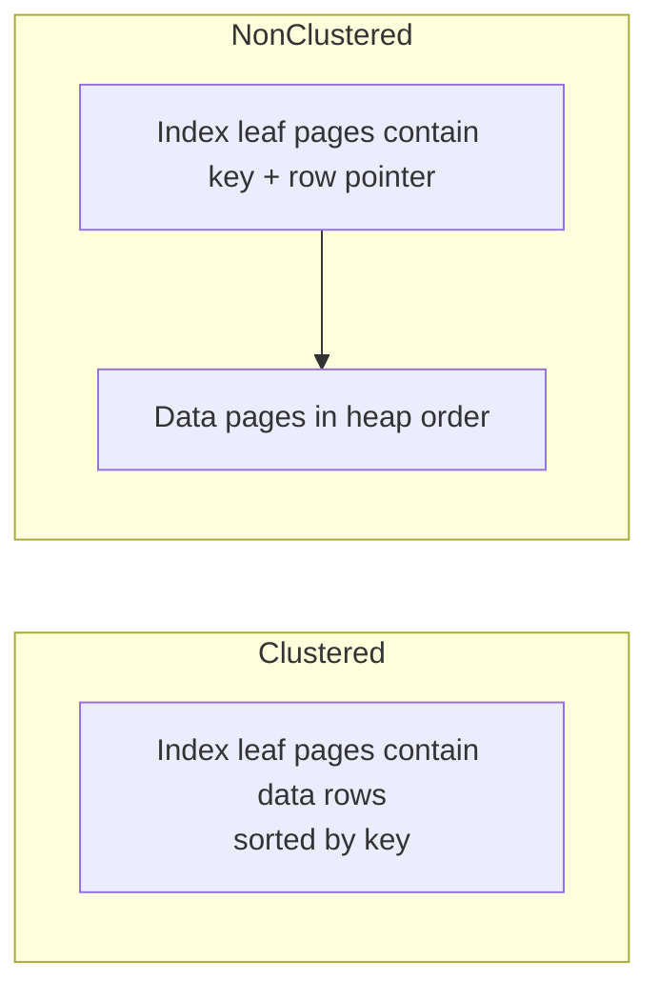

# Unit 6 — Indexing Mechanism

> **Syllabus (DJS23IPC202, 3 hrs):** Types of indexes — single-level ordered indexes, multilevel indexes, overview of B-trees and B+ trees.
>
> **Past-paper coverage:** Need for indexing, primary/secondary indexes, dense/sparse, clustered index, single-level vs multilevel, B-tree and B+ tree properties, insertion with node splits (order 3, 4, 5), B+ tree search on disk, CRUD on B+ tree, hashing vs indexing, limitations of hashing.

**Source codes**

| Code | Paper |
|---|---|
| IT-F24 | IT Final 2024-25 (Dec 2024) |
| IT-R25 | IT Re-Exam 2024-25 (Mar 2025) |
| CO-F24 | Comp Final 2024-25 (Dec 2024) |
| CO-R25 | Comp Re-Exam 2024-25 (Mar 2025) |
| IO-F24 | IOT Final 2024-25 (Dec 2024) |
| DS-F24 | DS Final 2024-25 (Dec 2024) |
| DS-R25 | DS Re-Exam 2024-25 (Mar 2025) |
| IT-F25 | IT Final 2025-26 (Dec 2025) |
| IT-R26 | IT Re-Exam 2025-26 (Mar 2026) |
| AI-R26 | AIDS Re-Exam 2025-26 (Mar 2026) |
| IC-R26 | CSE (ICB) Re-Exam 2025-26 (Mar 2026) |
| CO-R26 | Comp Re-Exam 2024-25 batch (Mar 2026) |
| CO-B26 | 2023-24 Backlog Re-Exam (Mar 2026) |

---

## 6.1 What is indexing? Why is it useful? **[5]**

**Asked in:** IT-F25 Q4(A)(1).

**Question (verbatim):**
> What is Indexing. Discuss how indexing is useful in databases.

**Answer**

An **index** is an auxiliary data structure that stores search-key values with pointers to the corresponding records, allowing the DBMS to locate rows without scanning the entire table. It works like the index of a book: instead of reading every page, you look up the key and go directly to the page.

**How it improves performance**

1. **Faster selection:** `WHERE EmpID = 101` can use an index lookup instead of a full table scan.
2. **Faster joins:** indexes on join columns reduce matching cost.
3. **Faster sorting/grouping:** an ordered index can supply rows in sorted order for `ORDER BY`/`GROUP BY`.
4. **Range queries:** B+ tree indexes efficiently answer `BETWEEN`, `>`, `<`.
5. **Uniqueness enforcement:** primary key and unique constraints are implemented with indexes.
6. **Covering indexes:** if the index contains all selected columns, the table need not be read.
7. **Less I/O:** fewer disk blocks are read, which matters most for large tables.

**Trade-offs:** indexes consume storage and slow down `INSERT`/`UPDATE`/`DELETE` because every index must be maintained. Index the columns used in selective `WHERE`, join and `ORDER BY` clauses; avoid indexing low-selectivity columns.

---

## 6.2 Primary, secondary, dense, sparse and clustered indexes **[5–10]**

**Asked in:** AI-R26 Q1(B) **[5]**; CO-B26 Q4(B)(i) (clustered index).

**Questions (verbatim):**
> Describe Primary and Secondary indexing in a database management system? Explain how it improves the performance of query processing.
>
> Discuss cluster index with example.

**Answer**

### Primary index

- Defined on the **ordering key field** of a data file that is physically sorted on that field.
- Usually **sparse**: one index entry per data block, containing the block's first key and a pointer.
- There is at most one primary index per file (because the file has one physical order).

### Secondary index

- Defined on a **non-ordering field** (an alternate search key).
- Usually **dense**: one entry per record (or per distinct key value) with a pointer to the record.
- A file can have many secondary indexes.
- Often multilevel to reduce the size of the index.

**Example:** An `Employee` file is physically sorted by `EmpID`. A secondary index on `Name` stores entries such as `(Aarav → block 3, slot 2)`, `(Diya → block 7, slot 1)`, `(Rohan → block 2, slot 4)`. Because the file is not sorted by `Name`, the index must have an entry for each record (dense) and a record pointer. A query `WHERE Name = 'Diya'` reads the index, finds the pointer, and fetches only that record instead of scanning the whole file.

**Purpose of a secondary index:** it provides an additional access path for a non-primary-key column, improving the performance of equality and range queries on that column without changing the physical order of the data. The trade-off is extra storage and maintenance on inserts/updates/deletes.

### Dense vs sparse index

| Index | Entries | Example |
|---|---|---|
| **Dense** | One entry for every search-key value/record | Secondary index on `Name` |
| **Sparse** | Entries for some values (e.g., first key of each block) | Primary index on `EmpID` of a sorted file |

A sparse index is smaller but requires the data file to be ordered; a dense index can be used on any field.

### Clustered index

- The data file is **physically ordered on the index key**; the index's leaf level contains the actual data pages (or the data is stored in the index order).
- A table can have **at most one clustered index**.
- Excellent for range queries and ordered retrieval; expensive for inserts that change the order.
- Example: `CREATE CLUSTERED INDEX idx_emp ON Employee(EmpID);` (SQL Server). In Oracle, an index-organized table is similar.

### Non-clustered index

- A separate structure with key values and pointers (row IDs) to the data rows.
- Many non-clustered indexes per table; each lookup may require an extra I/O to fetch the row.



**Example:** A table `Employee(EmpID, Name, DeptID)` with a clustered index on `EmpID` stores rows in EmpID order. A non-clustered index on `Name` stores Name + row pointer; a name lookup reads the index, then fetches the row.

---

## 6.3 Single-level vs multilevel ordered indexes **[8]**

**Asked in:** IO-F24 Q4(B)(ii).

**Question (verbatim):**
> Explain the difference between single-level ordered indexes and multilevel indexes.

**Answer**

### Single-level ordered index

- One index file whose entries are sorted by the search key.
- Each entry is a `(key, pointer)` pair.
- Search: binary search over the index, then follow the pointer to the data block.
- For a large file, the index itself becomes large; searching it may require several disk I/Os.

```text
Index:  [10|●] [20|●] [30|●] [40|●] [50|●] ...
Data:   block for 10, block for 20, ...
```

### Multilevel index

- The index is itself indexed: the first-level index points to second-level blocks, the second level points to the data, and so on.
- The top level is small enough to stay in main memory.
- Search descends level by level, reducing disk I/Os.
- A B-tree/B+ tree is a dynamic multilevel index.

```text
Level 2 (top):     [1–50 | ●] [51–100 | ●]
Level 1:           [1–10|●] [11–20|●] ... [51–60|●] ...
Data blocks:       records ...
```

**Comparison**

| Point | Single-level | Multilevel |
|---|---|---|
| Structure | One index file | Index on index (tree) |
| Index size | Large for big files | Smaller at each level |
| Search cost | More I/Os as index grows | Fewer I/Os; top level cached |
| Updates | Rebuilding/shifting entries | Node splits/merges (B-tree/B+ tree) |
| Example | Sorted index file | B-tree, B+ tree |

---

## 6.4 B-tree **[5–10]**

**Asked in:** IT-F24 Q1(B) (discuss with example) **[5]**; DS-F24 Q1(B)(1) (insert order 3) **[10]**; DS-R25 Q1(B)(1) (insert order 4) **[10]**; IC-R26 Q4(a) (insert order 3) **[10]**; CO-R26 Q7 (explain with example).

**Questions (verbatim):**
> Discuss B-tree with the help of an example.
>
> Explain BTrees with example.
>
> Insert in B-tree of order 3, insert the following keys: 5, 15, 25, 35, 45, 55, 65. Show the resulting B-tree structure after each insertion, including any node splits.
>
> Given an empty B-tree of order 4, insert the following keys one by one: 15, 30, 50, 5, 10, 40, 20. Illustrate each step of insertion, including any necessary node splits, and show the final structure of the B-tree.
>
> Insert the keys 78, 52, 81, 40, 33, 90, 85, 20, and 38 in this order in an initially empty B tree of order 3.

**Answer**

A **B-tree** is a balanced multiway search tree. Each node contains sorted keys and child pointers; data pointers may appear in internal nodes as well as leaves.

**Properties of a B-tree of order `m`**

1. Every node has at most `m` children and at most `m−1` keys.
2. Every node except the root has at least `⌈m/2⌉` children and at least `⌈m/2⌉−1` keys.
3. The root has at least 2 children (unless it is a leaf).
4. All leaves are at the same level (balanced).
5. Keys in a node are sorted; for a key `Ki`, all keys in the left subtree are smaller and all keys in the right subtree are larger.
6. Search, insert and delete are `O(log n)`.

**Search:** start at the root; compare the search key with the node's keys; follow the appropriate child pointer; repeat until found or a leaf is reached.

**Insertion algorithm**

1. Search for the leaf where the key belongs.
2. Insert the key in sorted order.
3. If the node overflows (has `m` keys), split it:
   - Left part keeps `⌈m/2⌉−1` keys.
   - Median key is promoted to the parent.
   - Right part keeps the remaining keys.
4. If the parent overflows, split it too; this may propagate to the root. If the root splits, a new root is created and the tree grows in height.

### Example 1 — B-tree of order 3, insert 5, 15, 25, 35, 45, 55, 65

Order 3 means **max 2 keys per node** (max 3 children).

| Insert | Tree after insertion |
|---|---|
| 5 | `[5]` |
| 15 | `[5, 15]` |
| 25 | `[5, 15, 25]` overflows → split: root `[15]`, children `[5]`, `[25]` |
| 35 | `[15]`; right child `[25, 35]` |
| 45 | `[25, 35, 45]` overflows → promote 35: root `[15, 35]`, children `[5]`, `[25]`, `[45]` |
| 55 | right child `[45, 55]` |
| 65 | `[45, 55, 65]` overflows → promote 55: root `[15, 35, 55]`, children `[5]`, `[25]`, `[45]`, `[65]` |

Final:

```text
              [15 | 35 | 55]
             /      |      |      \
          [5]     [25]   [45]    [65]
```

### Example 2 — B-tree of order 4, insert 15, 30, 50, 5, 10, 40, 20

Order 4 means **max 3 keys per node**.

| Insert | Tree after insertion |
|---|---|
| 15 | `[15]` |
| 30 | `[15, 30]` |
| 50 | `[15, 30, 50]` |
| 5 | `[5, 15, 30, 50]` overflows → split: left `[5]`, promote 15, right `[30, 50]`; root `[15]` |
| 10 | left child `[5, 10]` |
| 40 | right child `[30, 40, 50]` |
| 20 | insert 20 into right child → `[20, 30, 40, 50]` overflows → left `[20]`, promote 30, right `[40, 50]`; root `[15, 30]` |

Final:

```text
                 [15 | 30]
                /    |    \
          [5, 10]  [20]  [40, 50]
```

### Example 3 — B-tree of order 3, insert 78, 52, 81, 40, 33, 90, 85, 20, 38

Order 3 → max 2 keys per node.

| Insert | Tree after insertion |
|---|---|
| 78 | `[78]` |
| 52 | `[52, 78]` |
| 81 | `[52, 78, 81]` overflows → root `[78]`, children `[52]`, `[81]` |
| 40 | left child `[40, 52]` |
| 33 | `[33, 40, 52]` overflows → promote 40: root `[40, 78]`, children `[33]`, `[52]`, `[81]` |
| 90 | right child `[81, 90]` |
| 85 | `[81, 85, 90]` overflows → promote 85: root `[40, 78, 85]` overflows → promote 78: new root `[78]`; left `[40]`, right `[85]` |
| 20 | leftmost leaf `[20, 33]` |
| 38 | `[20, 33, 38]` overflows → promote 33 into `[40]`, giving `[33, 40]`; children `[20]`, `[38]`, `[52]` |

Final:

```text
                     [78]
                    /    \
              [33 | 40]   [85]
             /    |    \   /  \
          [20]  [38]  [52] [81] [90]
```

**Height:** all leaves are at the same level; a B-tree with a high order has a small height, so search takes few disk I/Os.

---

## 6.5 B+ tree **[5–10]**

**Asked in:** DS-F24 Q1(B)(2) (order 5) **[10]**; DS-R25 Q1(B)(2) (order 4) **[10]**; CO-R25 Q4(B) (concept + CRUD) **[5]**; IT-R26 Q4(A)(1) (search a file on disk) **[10]**.

**Questions (verbatim):**
> Construct a B+ tree of order 5 by inserting keys 12, 25, 35, 47, 50. Illustrate each step of the insertion process.
>
> Given a B+ tree of order 4, insert the keys 3, 8, 14, 18, 22 in sequence. Show the B+ tree at each step.
>
> Discuss B+ Tree with the help of an example. How can a B+ tree be used to search a particular file stored on disks?
>
> Explain concept of B+ trees in brief and discuss any one CRUD operation.

**Answer**

A **B+ tree** is a balanced multiway search tree in which:
- **Internal nodes** contain only separator keys and child pointers (no data pointers).
- **Leaf nodes** contain all search-key values and pointers to the actual records (or the records themselves in a clustered index).
- Leaves are linked in a doubly linked list, enabling efficient range scans.
- All leaves are at the same level.

**Properties (order `m`)**

1. Internal nodes: at most `m` children, `m−1` keys.
2. Leaf nodes: at most `m−1` keys (using the convention in this file), all at the same level.
3. Every internal node (except root) has at least `⌈m/2⌉` children.
4. All keys appear in the leaves; internal keys are copies/separators.
5. Search always reaches a leaf.
6. Range queries are efficient because leaves are linked.

### Example 1 — B+ tree of order 5, insert 12, 25, 35, 47, 50

Order 5 → max 4 keys per node.

| Insert | Tree after insertion |
|---|---|
| 12, 25, 35, 47 | leaf `[12, 25, 35, 47]` (full) |
| 50 | leaf `[12, 25, 35, 47, 50]` overflows → split into left `[12, 25, 35]` and right `[47, 50]`; copy up 47 as separator |

Final:

```text
                [47]
               /    \
     [12, 25, 35]  [47, 50]  →  (leaves linked)
```

**Search for 50:** compare with 47 at the root → go right → scan leaf `[47, 50]` → found. Two block reads (root + leaf).

### Example 2 — B+ tree of order 4, insert 3, 8, 14, 18, 22

Order 4 → max 3 keys per node.

| Insert | Tree after insertion |
|---|---|
| 3, 8, 14 | leaf `[3, 8, 14]` (full) |
| 18 | `[3, 8, 14, 18]` overflows → left `[3, 8]`, right `[14, 18]`, copy up 14 |
| 22 | goes right → leaf `[14, 18, 22]` |

Final:

```text
                [14]
               /    \
          [3, 8]   [14, 18, 22]
```

### B+ tree search on disk (IT-R26 Q4(A)(1))

To search a file stored on disk:

1. Read the **root** block into memory.
2. Compare the search key with the separators; choose the child pointer.
3. Read the corresponding child block; repeat until a leaf is reached.
4. In the leaf, find the key and follow its record pointer to the data block (or read the record directly in a clustered B+ tree).

If the tree has height `h`, a search needs about `h + 1` block reads. Because internal nodes have high fan-out, `h` is typically 3–4 even for millions of records, so searches are fast. The top levels are often cached in the buffer pool, reducing I/O further.

### B+ tree CRUD operations (CO-R25 Q4(B))

- **Create/Insert:** find the leaf; insert the key in sorted order. If the leaf overflows, split it, copy the first key of the right leaf to the parent, and propagate splits upward. If the root splits, create a new root.
- **Read/Search:** descend from the root using separators; scan the leaf for the key (or use binary search); follow the record pointer.
- **Update:** if the key is unchanged, update the record in place; if the key changes, delete the old key and insert the new one.
- **Delete:** remove the key from the leaf. If the leaf underflows (fewer than `⌈m/2⌉−1` keys), borrow from a sibling or merge with a sibling; update/remove the separator in the parent; propagate if necessary.

**Why B+ trees are preferred in DBMS:** all data pointers are in leaves, so internal nodes have higher fan-out and the tree is shorter; leaves are linked for range scans; search cost is predictable.

### B-tree vs B+ tree

| Point | B-tree | B+ tree |
|---|---|---|
| Data pointers | In internal and leaf nodes | Only in leaf nodes |
| Internal node content | Keys + data pointers + child pointers | Separators + child pointers |
| Search | May stop at an internal node | Always reaches a leaf |
| Range scan | Requires tree traversal | Linked leaves make it efficient |
| Fan-out | Lower (data pointers consume space) | Higher (separators only) |
| Height | Slightly taller | Shorter |
| Use | General-purpose index | Standard DBMS index |

---

## 6.6 Hashing vs indexing; limitations of hashing **[5–10]**

**Asked in:** CO-F24 Q4(B) **[5]**; DS-R25 Q1(B)(1) (limitations of hashing) **[10]**.

**Questions (verbatim):**
> Differentiate between hashing and indexing in DBMS.
>
> What are the limitations of hashing?

**Answer**

### Hashing

A hash file uses a **hash function** `h(key)` to map a search key to a bucket address. Insert/search/delete are usually `O(1)` for equality conditions.

### Indexing

An index (e.g., B+ tree) stores keys in sorted order with pointers. Search is `O(log n)`, and range/order queries are supported.

**Comparison**

| Point | Hashing | Indexing (B+ tree) |
|---|---|---|
| Search type | Equality only (typically) | Equality, range, prefix, order |
| Average search | O(1) | O(log n) |
| Range queries | Poor/not supported | Efficient (linked leaves) |
| Ordering | None | Sorted order maintained |
| Collisions | Possible; need chaining/open addressing | No collisions; balanced tree |
| Overflow | Bucket overflow handling | Node splits |
| Storage | Hash table + overflow chains | Index nodes + pointers |
| Use case | Exact-match lookups, joins on equality | General-purpose DBMS indexes, range queries |

### Limitations of hashing

1. **Collisions:** different keys can hash to the same bucket; chaining/open addressing degrades performance.
2. **No order:** hashing does not maintain sorted order, so `ORDER BY`, `BETWEEN`, `>`, `<` and prefix queries are inefficient or impossible.
3. **Dependence on a good hash function:** a poor function causes clustering and uneven distribution.
4. **Memory overhead:** the hash table and overflow structures consume space; a low load factor wastes memory.
5. **Rehashing cost:** when the table grows, all keys may need to be redistributed.
6. **Bucket overflow:** skewed data can create long overflow chains, increasing search time.
7. **Dynamic data:** frequent insertions/deletions require overflow management or periodic reorganization.
8. **No partial-key search:** hashing the whole key does not help with `LIKE 'A%'`.

> **Out-of-syllabus note:** *Dynamic hashing* (extendible hashing, linear hashing) addresses bucket growth by splitting buckets incrementally. It was asked in the 2023-24 backlog paper but is not part of the DJS23 IPC202 syllabus; see the index for the out-of-syllabus list.

---

## 6.7 Clustered index with example **[5]**

**Asked in:** CO-B26 Q4(B)(i).

**Question (verbatim):**
> Discuss cluster index with example.

**Answer**

A **clustered index** stores the data rows in the same order as the index key. The leaf level of the index contains the actual data pages, so the table is physically sorted by the clustering key.

**Example**

```sql
CREATE TABLE Employee (
    EmpID INT PRIMARY KEY,
    Name VARCHAR(50),
    DeptID INT
);

CREATE CLUSTERED INDEX idx_emp_id ON Employee(EmpID);
```

Rows are stored in ascending `EmpID` order:

```text
Data pages: [101, 102, 103] → [104, 105, 106] → ...
```

**Advantages**

- Very fast range queries (`BETWEEN`, `>`, `<`) and `ORDER BY` on the clustering key.
- One clustered index per table (the physical order is unique).
- Good locality for sequential access.

**Disadvantages**

- Inserting a row in the middle may require page splits and row movement.
- Updating the clustering key is expensive.
- Only one clustered index per table; other indexes are non-clustered.

**Clustered vs non-clustered**

| Point | Clustered | Non-clustered |
|---|---|---|
| Data order | Physically sorted by key | Heap order; index separate |
| Leaf content | Actual data rows | Key + row pointer |
| Number per table | One | Many |
| Range scan | Very fast | Slower (many row lookups) |
| Insert cost | Higher (order maintenance) | Lower |

---

## 6.8 Indexing — quick revision checklist

- [ ] Definition of index and 5 benefits
- [ ] Primary vs secondary index; dense vs sparse
- [ ] Clustered vs non-clustered index
- [ ] Single-level vs multilevel index
- [ ] B-tree properties (order, min/max keys, balanced)
- [ ] B-tree insertion with splits (order 3 and 4 examples)
- [ ] B+ tree properties (all keys in leaves, linked leaves)
- [ ] B+ tree insertion (order 4 and 5 examples)
- [ ] B+ tree search: root → internal → leaf → data; `h+1` I/Os
- [ ] B+ tree CRUD: insert/split, delete/merge, update
- [ ] B-tree vs B+ tree comparison
- [ ] Hashing vs indexing; limitations of hashing
- [ ] Clustered index example and trade-offs